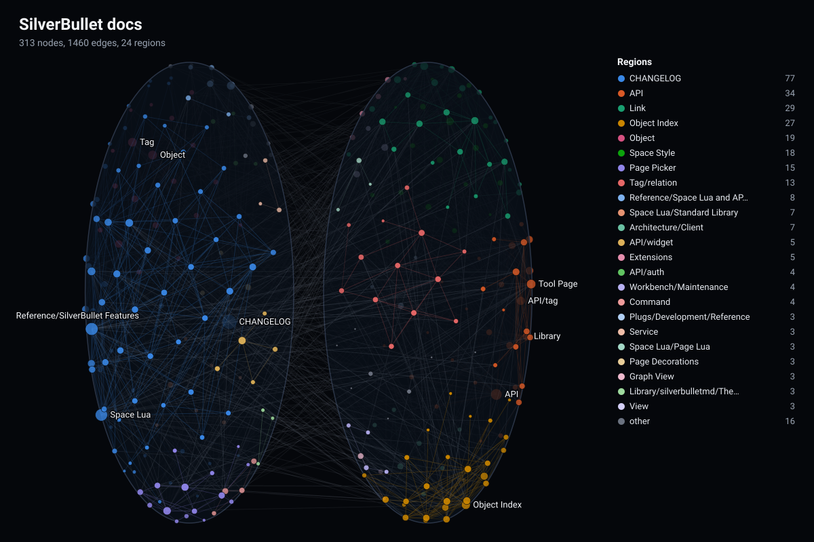
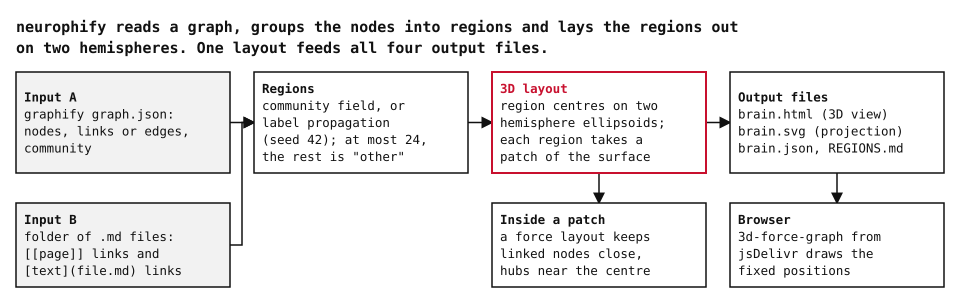

# neurophify

neurophify draws a knowledge graph as a 3D brain: it reads a graphify `graph.json` or a folder of Markdown notes, groups the nodes into regions, lays the regions out on two hemispheres, replays their growth over time and keeps the 20 most important nodes in `CORE.md`.

[](https://github.com/maciejszulia/neurophify/actions/workflows/ci.yml)

[Polska wersja](README.pl.md)

## Demo



The picture is [`docs/demo/brain.svg`](docs/demo/brain.svg), made from the documentation of SilverBullet. The interactive 3D version runs on GitHub Pages: [maciejszulia.github.io/neurophify/demo/brain.html](https://maciejszulia.github.io/neurophify/demo/brain.html). Press Play on its time bar to watch the documentation grow from its first page in 2022 to 313 pages. The text reports are [`docs/demo/REGIONS.md`](docs/demo/REGIONS.md) (regions, time, graph metrics) and [`docs/demo/CORE.md`](docs/demo/CORE.md) (the 20 pages with the largest weight).

## Results

| Input | Nodes | Edges | Regions | Connected components | Modularity Q | Run time |
|---|---|---|---|---|---|---|
| SilverBullet `docs/` folder, Markdown | 313 | 1460 | 24 | 8 | 0.3582 | 0.57 s to 0.64 s (5 runs) |
| graphify `graph.json` of a TypeScript code base | 2731 | 4386 | 24 | 162 | 0.5794 | 1.23 s to 1.45 s (5 runs) |

Measured on 2026-11-15 with neurophify 1.2.0 and the shell's `time python3 neurophify.py ...` on a ThinkPad T470p (Intel Core i7-7700HQ, load average 4.8 from other work), Python 3.14.8. The components and Q come from `REGIONS.md` of the same runs. The Markdown run includes one `git log` over the whole history of the SilverBullet repository. Two runs on the same input write byte-identical files.

## Quick start

```bash
git clone https://github.com/maciejszulia/neurophify.git
cd neurophify
python3 neurophify.py --selftest
python3 neurophify.py examples/graph.json
python3 neurophify.py . --title "This repository"
```

`examples/graph.json` is the call graph of `neurophify.py`, with a community and a time for each function. The last command draws the Markdown files of this repository. To rebuild the demo from the SilverBullet documentation:

```bash
git clone https://github.com/silverbulletmd/silverbullet.git ../silverbullet
git -C ../silverbullet checkout a0ab7e9d
python3 neurophify.py ../silverbullet/docs --title "SilverBullet docs" --out docs/demo
```

Clone the whole history: in a clone made with `--depth 1` every page has the time of the one commit.

The tool needs Python 3.11 or newer and nothing outside the standard library. Each run writes five files to `neurophify-out/` (change it with `--out DIR`):

| File | Content |
|---|---|
| `brain.html` | Interactive 3D view: drag to rotate, scroll to zoom, hover a node to read its name, click a node to fly to it, play the time bar to watch the graph grow. |
| `brain.svg` | Static picture of the same scene, seen from the same direction. |
| `brain.json` | Nodes with positions, regions and times, edges, regions. |
| `REGIONS.md` | Each region with its size, its 5 central nodes and its bridges to other regions; the Time section; graph metrics. |
| `CORE.md` | The 20 nodes with the largest weight: region, degree, last change, weight and, for a Markdown folder, the first paragraph of the page. |

Other inputs:

```bash
python3 neurophify.py graphify-out/graph.json                       # a graph written by graphify
python3 neurophify.py notes/ --exclude '_archive' --exclude 'drafts/*' --title "My notes"
python3 neurophify.py --help                                        # all options, exit codes
```

With Docker, from the folder that holds `graph.json`:

```bash
docker run --rm -v "$PWD:/data" ghcr.io/maciejszulia/neurophify /data/graph.json --out /data/out
```

The `image` workflow publishes the image to the GitHub Container Registry when a `v*` tag is pushed; `docker build -t neurophify .` builds the same image locally. The container runs as root, so the files in `out/` belong to root; add `--user "$(id -u):$(id -g)"` to keep them yours.

`SKILL.md` makes the repository usable as an agent skill: link the folder into your skills directory and ask for "/neurophify" or "3D graph".

## How it works



1. Load. A file is read as a graphify `graph.json` in the networkx node-link format: `nodes` with `id`, `label` and `community`, and `links` or `edges` with `source` and `target`. A folder is read as Markdown: each `.md` file is a node, and `[[page]]`, `[[page|alias]]` and `[text](file.md)` links are edges. Links inside code blocks, hidden folders and the output folder are skipped.
2. Time. In a folder inside a git repository each page takes its first and last commit from one `git log`; a page with uncommitted changes takes the later of its last commit and its modification time as its last change. Outside git, the file modification time is both. A `graph.json` node may carry `"time"` as ISO 8601 or epoch seconds. `brain.html` shows a time bar with a Play button, and the Time section of `REGIONS.md` names the busiest day, the new nodes per month and, for the 30 days before the last change, each region as growing, active or dormant.
3. Regions. The `community` field of `graph.json` defines the regions. Without it, label propagation finds them (seed 42, at most 50 iterations); the 5 % of nodes with the most edges take a region but do not vote, so an index page does not pull every topic into one region. The legend keeps the 23 largest regions and merges the rest into "other".
4. Layout. Each hemisphere is an ellipsoid. Region centres lie on its surface along a Fibonacci spiral, and each region takes the surface points nearest its centre, as many as it has nodes, so it forms one patch. Inside the patch a force layout keeps linked nodes close and puts hubs near the centre.
5. Output. `brain.html` embeds the data and pins every node to its position (`fx`, `fy`, `fz`) in [3d-force-graph](https://github.com/vasturiano/3d-force-graph) 1.80.1. `brain.svg` projects the same positions from the same camera direction. Node size grows with the number of edges, and the 10 nodes with the most edges carry a permanent label.
6. Consolidation. `CORE.md` lists the 20 nodes with the largest weight

   $$w(v) = \bigl(1 + \deg(v)\bigr) \cdot 2^{-d(v)/30}$$

   where $\deg(v)$ is the number of edges of node $v$ and $d(v)$ is the number of days between the last change of $v$ and the newest change in the graph; a node without a time has $d(v) = 0$. A node loses half its weight for every 30 days without a change, and the 1 keeps a node without edges in the ranking. Ties go to the label, then the id. For a Markdown folder each entry adds the first paragraph of the page, without YAML frontmatter, headings and code blocks, at most 300 characters; the paragraph stays out of `brain.html` and `brain.json`.
7. Graph metrics. `REGIONS.md` ends with the number of connected components, the size of the largest one, the number of nodes without edges and the modularity of the regions

   $$Q = \sum_c \left[\frac{L_c}{m} - \left(\frac{D_c}{2m}\right)^2\right]$$

   where $L_c$ is the number of edges inside region $c$, $D_c$ is the sum of the degrees of the nodes of region $c$ and $m$ is the number of edges. "other" counts as one region, and a graph without edges has $Q = 0$.

## Relation to graphify

graphify builds a knowledge graph from code and documents and writes `graphify-out/graph.json`. neurophify reads that file and adds the third dimension. The code of graphify is not part of this repository, and neurophify runs without graphify: a folder of Markdown files is enough.

## Limits

- Regions from label propagation are a heuristic: with another seed, region borders move.
- The 3D view in `brain.html` loads 3d-force-graph from jsDelivr and needs a network connection; `brain.svg`, `REGIONS.md` and `CORE.md` work offline.
- In a region with more than 770 nodes the force layout is skipped and the hubs take the points nearest the centre.
- The legend shows at most 24 regions. "other" collects the smaller ones and can span both hemispheres.
- Edges are drawn without direction; edge types from `graph.json` are not shown.
- Only `.md` files are nodes; a link to a page that does not exist is dropped.
- A renamed file starts its time at the rename, because `git log` runs without `--follow`.
- The weight in `CORE.md` counts edges and the age of the last change; it does not read the text of a page.
- The Docker image has no git, so a Markdown folder takes the file modification time.

## License and author

MIT, see [LICENSE](LICENSE). Author: Maciej Szulia.

Demo data: the `docs/` folder of [SilverBullet](https://github.com/silverbulletmd/silverbullet) at commit `a0ab7e9d`, read on 2026-11-15, MIT license, Copyright 2022 Zef Hemel. `docs/demo/` holds page names, links and commit times derived from that folder, and `docs/demo/CORE.md` quotes the first paragraph of 20 pages, at most 300 characters each.
