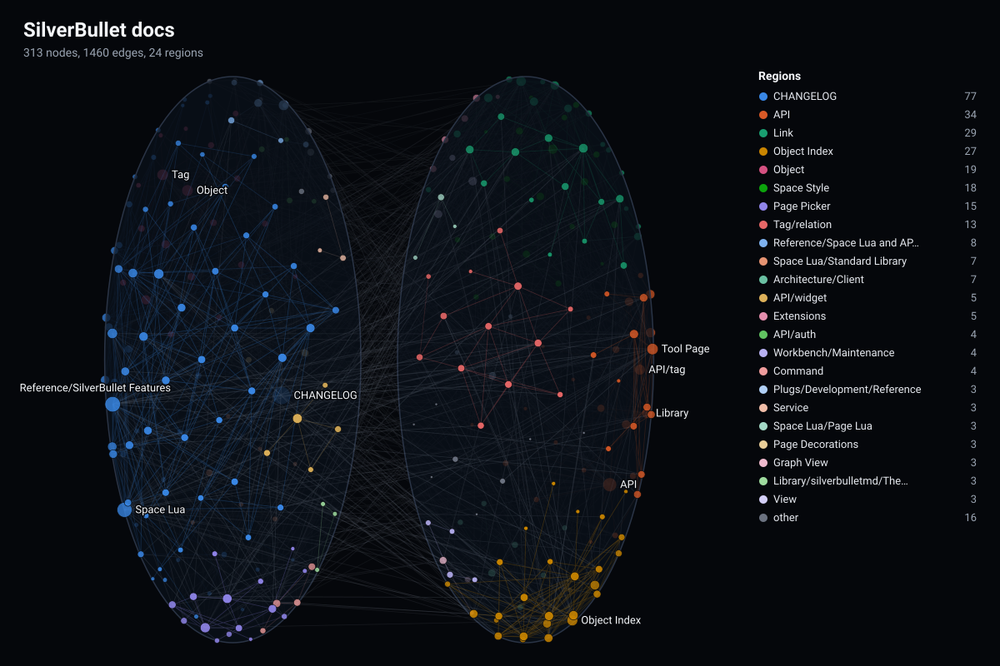
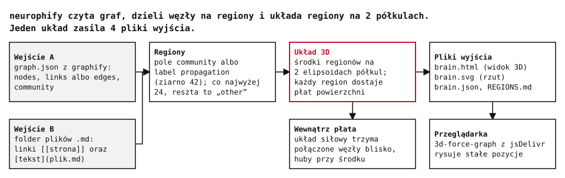

# neurophify

Narzędzie neurophify rysuje graf wiedzy jako mózg w 3D. Narzędzie czyta plik `graph.json` z graphify albo folder notatek Markdown. Narzędzie dzieli węzły na regiony oraz układa regiony na 2 półkulach.

[English version](README.md)

Legenda: słowo „lub” oznacza co najmniej 1 człon. Słowo „albo” oznacza dokładnie 1 człon.

## Słownik

| Termin | Definicja | Słowa zakazane dla tego pojęcia |
|---|---|---|
| węzeł | Strona Markdown albo węzeł z pliku `graph.json`. | punkt, element |
| krawędź | Link, który łączy 2 węzły. | połączenie, relacja |
| region | Grupa węzłów, którą narzędzie rysuje 1 kolorem na 1 płacie półkuli. | klaster, społeczność |
| płat | Część powierzchni półkuli, na której leżą węzły 1 regionu. | obszar, plama |
| most | Krawędź, która łączy węzły z 2 różnych regionów. | łącznik |
| hub | Węzeł, który należy do 5 % węzłów z największą liczbą krawędzi. | centrum |
| label propagation | Algorytm, który daje węzłowi region przeważający wśród sąsiadów węzła. | klasteryzacja |
| układ siłowy | Algorytm, który przyciąga połączone węzły oraz odpycha od siebie każde 2 węzły. | symulacja |
| folder wyjścia | Folder, do którego narzędzie zapisuje 4 pliki wyjścia. | katalog wyników |
| skill | Folder z plikiem `SKILL.md`, który opisuje agentowi kroki zadania. | wtyczka |

Skróty: 3D oznacza 3 wymiary. HTML, SVG, JSON oraz Markdown oznaczają formaty plików.

## Demo



Rysunek to plik [`docs/demo/brain.svg`](docs/demo/brain.svg). Źródłem rysunku jest dokumentacja SilverBulleta. Wersja interaktywna 3D to plik [`docs/demo/brain.html`](docs/demo/brain.html). GitHub pokazuje plik HTML jako kod źródłowy. Sklonuj repozytorium i otwórz plik `docs/demo/brain.html` w przeglądarce. Raport tekstowy to plik [`docs/demo/REGIONS.md`](docs/demo/REGIONS.md).

## Wyniki

- Folder `docs/` SilverBulleta: 313 węzłów, 1460 krawędzi, 24 regiony. Czas przebiegu: od 0,40 s do 0,43 s włącznie w 3 przebiegach.
- Plik `graph.json` z graphify dla kodu TypeScript: 2731 węzłów, 4386 krawędzi, 24 regiony. Czas przebiegu: 1,10 s.

Pomiar: 2026-11-15, komenda powłoki `time python3 neurophify.py ...`, komputer ThinkPad T470p z procesorem Intel Core i7-7700HQ, Python w wersji 3.14.8. Dla tego samego wejścia 2 przebiegi zapisują identyczne pliki.

## Szybki start

```bash
git clone https://github.com/maciejszulia/neurophify.git
cd neurophify
python3 neurophify.py --selftest
python3 neurophify.py . --title "This repository"
```

Komenda w wierszu 4 rysuje pliki Markdown tego repozytorium. Komendy, które odtwarzają demo z dokumentacji SilverBulleta:

```bash
git clone --depth 1 https://github.com/silverbulletmd/silverbullet.git ../silverbullet
python3 neurophify.py ../silverbullet/docs --title "SilverBullet docs" --out demo-out
```

Narzędzie wymaga Pythona w wersji 3.11 lub nowszej. Narzędzie używa tylko biblioteki standardowej. Każdy przebieg zapisuje 4 pliki w folderze `neurophify-out/`. Opcja `--out FOLDER` zmienia folder wyjścia.

| Plik | Zawartość |
|---|---|
| `brain.html` | Interaktywny widok 3D. Przeciągnij mysz, żeby obrócić mózg. Najedź na węzeł, żeby odczytać nazwę węzła. Kliknij węzeł, żeby przybliżyć kamerę do węzła. |
| `brain.svg` | Statyczny rysunek tej samej sceny z tego samego kierunku. |
| `brain.json` | Węzły z pozycjami oraz regionami, krawędzie, regiony. |
| `REGIONS.md` | Każdy region: liczba węzłów, 5 węzłów centralnych, mosty do innych regionów. |

Inne wejścia:

```bash
python3 neurophify.py graphify-out/graph.json                       # graf z graphify
python3 neurophify.py notes/ --exclude '_archive' --exclude 'drafts/*' --title "My notes"
python3 neurophify.py --help                                        # opcje oraz kody wyjścia
```

Plik `SKILL.md` pozwala użyć repozytorium jako skillu agenta. Utwórz w folderze skilli link do folderu repozytorium. Potem poproś agenta o „/neurophify” albo o „graf 3D”.

## Sposób działania



Narzędzie wykonuje każdy krok w tej kolejności:

1. Wczytanie. Narzędzie czyta plik jako `graph.json` z graphify w formacie node-link biblioteki networkx. Lista `nodes` zawiera pola `id`, `label` oraz `community`. Lista `links` albo lista `edges` zawiera pola `source` oraz `target`. Narzędzie czyta folder jako zbiór plików Markdown: każdy plik `.md` to węzeł, każdy link `[[strona]]`, `[[strona|alias]]` oraz `[tekst](plik.md)` to krawędź. Narzędzie pomija linki w blokach kodu, ukryte foldery oraz folder wyjścia.
2. Regiony. Pole `community` w pliku `graph.json` wyznacza regiony. Jeżeli pole `community` nie istnieje, to regiony wyznacza label propagation z ziarnem 42 w co najwyżej 50 iteracjach. Hub przyjmuje region od sąsiadów. Label propagation pomija głos huba. Powód: strona indeksu linkuje do każdego tematu, więc głos strony indeksu połączyłby tematy w 1 region. Legenda zawiera 23 największe regiony. Narzędzie łączy pozostałe regiony w region „other”.
3. Układ. Każda półkula to elipsoida. Środki regionów leżą na powierzchni elipsoidy wzdłuż spirali Fibonacciego. Każdy region zajmuje tyle punktów powierzchni, ile ma węzłów: punkty najbliższe środkowi regionu. Dlatego region tworzy 1 płat. Wewnątrz płata układ siłowy trzyma połączone węzły blisko siebie, a huby kładzie przy środku płata.
4. Wyjście. Plik `brain.html` osadza dane oraz przypina każdy węzeł do pozycji (`fx`, `fy`, `fz`) w bibliotece [3d-force-graph](https://github.com/vasturiano/3d-force-graph) w wersji 1.80.1. Plik `brain.svg` rzutuje te same pozycje z tego samego kierunku kamery. Rozmiar węzła rośnie z liczbą krawędzi. Stałą etykietę ma 10 węzłów z największą liczbą krawędzi.

## Związek z graphify

Skill graphify buduje graf wiedzy z kodu oraz dokumentów. Skill graphify zapisuje plik `graphify-out/graph.json`. Narzędzie neurophify czyta plik `graphify-out/graph.json` i dodaje trzeci wymiar. Kod graphify nie należy do repozytorium. Narzędzie neurophify działa bez graphify: folder plików Markdown wystarcza.

## Granice

- Regiony z label propagation to heurystyka. Przy innym ziarnie granice regionów przesuwają się.
- Widok 3D w pliku `brain.html` pobiera bibliotekę 3d-force-graph z serwera jsDelivr. Dlatego widok 3D wymaga dostępu do sieci. Pliki `brain.svg` oraz `REGIONS.md` działają bez sieci.
- Jeżeli region ma więcej niż 770 węzłów, to narzędzie pomija układ siłowy w tym regionie. Wtedy huby zajmują punkty najbliższe środkowi płata.
- Legenda pokazuje co najwyżej 24 regiony. Region „other” zbiera mniejsze regiony. Region „other” leży na 1 półkuli albo na 2 półkulach: narzędzie wybiera podział, który wyrównuje liczby węzłów na półkulach.
- Narzędzie rysuje krawędzie bez kierunku. Narzędzie pomija typy krawędzi z pliku `graph.json`.
- Tylko pliki `.md` są węzłami. Narzędzie pomija link do strony, której brak w folderze.

## Licencja i autor

Licencja MIT, patrz plik [LICENSE](LICENSE). Autor: Maciej Szulia.

Dane demo: folder `docs/` repozytorium [SilverBullet](https://github.com/silverbulletmd/silverbullet), commit `a0ab7e9d`, odczyt 2026-11-15, licencja MIT, Copyright 2022 Zef Hemel. Folder `docs/demo/` zawiera nazwy stron oraz linki z folderu `docs/` SilverBulleta.
