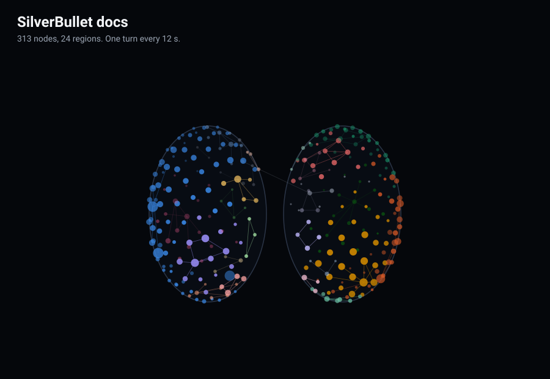

# neurophify

Narzędzie neurophify rysuje graf wiedzy jako mózg w 3D. Narzędzie czyta plik `graph.json` z graphify albo folder notatek Markdown. Narzędzie dzieli węzły na regiony, układa regiony na 2 półkulach oraz pokazuje wzrost grafu w czasie. Plik `CORE.md` zawiera 20 węzłów o największej ważności.

[](https://github.com/maciejszulia/neurophify/actions/workflows/ci.yml)

[English version](README.md)

Legenda: słowo „lub” oznacza co najmniej 1 człon. Słowo „albo” oznacza dokładnie 1 człon. Słowo MOŻE oznacza zezwolenie.

## Słownik

| Termin | Definicja | Słowa zakazane dla tego pojęcia |
|---|---|---|
| węzeł | Strona Markdown albo węzeł z pliku `graph.json`. | punkt, element. |
| krawędź | Link, który łączy 2 węzły. | połączenie, relacja. |
| stopień | Liczba krawędzi węzła. | waga. |
| region | Grupa węzłów, którą narzędzie rysuje 1 kolorem na 1 płacie półkuli. | klaster, społeczność. |
| płat | Część powierzchni półkuli, na której leżą węzły 1 regionu. | obszar, plama. |
| most | Krawędź, która łączy węzły z 2 różnych regionów. | łącznik. |
| hub | Węzeł, który należy do 5 % węzłów z największą liczbą krawędzi. | centrum. |
| label propagation | Algorytm, który daje węzłowi region przeważający wśród sąsiadów węzła. | klasteryzacja. |
| układ siłowy | Algorytm, który przyciąga połączone węzły oraz odpycha od siebie każde 2 węzły. | symulacja. |
| czas węzła | Para chwil: pierwsza zmiana węzła (pole `t`) oraz najnowsza zmiana węzła (pole `last`). | data, wiek. |
| ważność | Liczba $w(v)$ ze wzoru w kroku 6 sekcji „Sposób działania”. | priorytet, ranga. |
| konsolidacja | Zapis 20 węzłów o największej ważności w pliku `CORE.md`. | scalanie, merge. |
| składowa spójna | Zbiór węzłów, w którym ścieżka krawędzi łączy każde 2 węzły zbioru, bez krawędzi do węzła spoza zbioru. | grupa, wyspa. |
| modularność | Liczba $Q$ ze wzoru w kroku 7 sekcji „Sposób działania”. | jakość, spójność. |
| folder wyjścia | Folder, do którego narzędzie zapisuje 5 plików wyjścia. | katalog wyników. |
| skill | Folder z plikiem `SKILL.md`, który opisuje agentowi kroki zadania. | wtyczka. |
| image | Szablon kontenera Dockera z Pythonem oraz plikiem `neurophify.py`. | obraz. |

Skróty: 3D oznacza 3 wymiary. HTML, SVG, JSON oraz Markdown oznaczają formaty plików. CI oznacza continuous integration: GitHub Actions uruchamia testy po każdym pushu oraz dla każdego pull requesta.

## Demo



[Otwórz interaktywny model 3D w GitHub Pages](https://maciejszulia.github.io/neurophify/demo/brain.html). Przeciągnij mysz, żeby obrócić model. Przewiń, żeby powiększyć model.

Animacja to plik [`docs/demo/brain-spin.svg`](docs/demo/brain-spin.svg) z opcji `--spin`. Źródłem animacji jest dokumentacja SilverBulleta. Plik [`docs/demo/brain.svg`](docs/demo/brain.svg) to statyczny rysunek tej samej sceny. W modelu interaktywnym kliknij przycisk Play na pasku czasu. Wynik: widok 3D pokazuje wzrost dokumentacji w latach od 2022 do 2026 włącznie. Raporty tekstowe to pliki [`docs/demo/REGIONS.md`](docs/demo/REGIONS.md) oraz [`docs/demo/CORE.md`](docs/demo/CORE.md).

## Model 3D w tym README

GitHub wyświetla blok kodu `stl` z tej sekcji jako interaktywny model 3D. Przeciągnij mysz, żeby obrócić model. Model zawiera 2 półkule. Model zawiera też czworościan dla każdej z 40 stron z największą liczbą krawędzi grafu. Plik [`docs/demo/brain.stl`](docs/demo/brain.stl) powstaje z opcji `--stl`.

```stl
solid neurophify
facet normal 0.336 -0.038 0.941
outer loop
vertex -14.4 -0.0 15.5
vertex -9.4 -6.9 13.4
vertex -8.6 -0.0 13.4
endloop
endfacet
facet normal 0.797 -0.090 0.598
outer loop
vertex -8.6 -0.0 13.4
vertex -9.4 -6.9 13.4
vertex -5.7 -12.0 7.7
endloop
endfacet
facet normal 0.797 -0.090 0.598
outer loop
vertex -8.6 -0.0 13.4
vertex -5.7 -12.0 7.7
vertex -4.4 -0.0 7.7
endloop
endfacet
facet normal 0.974 -0.110 0.196
outer loop
vertex -4.4 -0.0 7.7
vertex -5.7 -12.0 7.7
vertex -4.4 -13.8 0.0
endloop
endfacet
facet normal 0.974 -0.110 0.196
outer loop
vertex -4.4 -0.0 7.7
vertex -4.4 -13.8 0.0
vertex -2.8 -0.0 0.0
endloop
endfacet
facet normal 0.974 -0.110 -0.196
outer loop
vertex -2.8 -0.0 0.0
vertex -4.4 -13.8 0.0
vertex -5.7 -12.0 -7.7
endloop
endfacet
facet normal 0.974 -0.110 -0.196
outer loop
vertex -2.8 -0.0 0.0
vertex -5.7 -12.0 -7.7
vertex -4.4 -0.0 -7.7
endloop
endfacet
facet normal 0.797 -0.090 -0.598
outer loop
vertex -4.4 -0.0 -7.7
vertex -5.7 -12.0 -7.7
vertex -9.4 -6.9 -13.4
endloop
endfacet
facet normal 0.797 -0.090 -0.598
outer loop
vertex -4.4 -0.0 -7.7
vertex -9.4 -6.9 -13.4
vertex -8.6 -0.0 -13.4
endloop
endfacet
facet normal 0.336 -0.038 -0.941
outer loop
vertex -8.6 -0.0 -13.4
vertex -9.4 -6.9 -13.4
vertex -14.4 -0.0 -15.5
endloop
endfacet
facet normal 0.252 -0.106 0.962
outer loop
vertex -14.4 -0.0 15.5
vertex -11.5 -12.0 13.4
vertex -9.4 -6.9 13.4
endloop
endfacet
facet normal 0.670 -0.282 0.687
outer loop
vertex -9.4 -6.9 13.4
vertex -11.5 -12.0 13.4
vertex -9.4 -20.7 7.7
endloop
endfacet
facet normal 0.670 -0.282 0.687
outer loop
vertex -9.4 -6.9 13.4
vertex -9.4 -20.7 7.7
vertex -5.7 -12.0 7.7
endloop
endfacet
facet normal 0.894 -0.375 0.245
outer loop
vertex -5.7 -12.0 7.7
vertex -9.4 -20.7 7.7
vertex -8.6 -23.9 0.0
endloop
endfacet
facet normal 0.894 -0.375 0.245
outer loop
vertex -5.7 -12.0 7.7
vertex -8.6 -23.9 0.0
vertex -4.4 -13.8 0.0
endloop
endfacet
facet normal 0.894 -0.375 -0.245
outer loop
vertex -4.4 -13.8 0.0
vertex -8.6 -23.9 0.0
vertex -9.4 -20.7 -7.7
endloop
endfacet
facet normal 0.894 -0.375 -0.245
outer loop
vertex -4.4 -13.8 0.0
vertex -9.4 -20.7 -7.7
vertex -5.7 -12.0 -7.7
endloop
endfacet
facet normal 0.670 -0.282 -0.687
outer loop
vertex -5.7 -12.0 -7.7
vertex -9.4 -20.7 -7.7
vertex -11.5 -12.0 -13.4
endloop
endfacet
facet normal 0.670 -0.282 -0.687
outer loop
vertex -5.7 -12.0 -7.7
vertex -11.5 -12.0 -13.4
vertex -9.4 -6.9 -13.4
endloop
endfacet
facet normal 0.252 -0.106 -0.962
outer loop
vertex -9.4 -6.9 -13.4
vertex -11.5 -12.0 -13.4
vertex -14.4 -0.0 -15.5
endloop
endfacet
facet normal 0.094 -0.148 0.985
outer loop
vertex -14.4 -0.0 15.5
vertex -14.4 -13.8 13.4
vertex -11.5 -12.0 13.4
endloop
endfacet
facet normal 0.298 -0.466 0.833
outer loop
vertex -11.5 -12.0 13.4
vertex -14.4 -13.8 13.4
vertex -14.4 -23.9 7.7
endloop
endfacet
facet normal 0.298 -0.466 0.833
outer loop
vertex -11.5 -12.0 13.4
vertex -14.4 -23.9 7.7
vertex -9.4 -20.7 7.7
endloop
endfacet
facet normal 0.499 -0.782 0.374
outer loop
vertex -9.4 -20.7 7.7
vertex -14.4 -23.9 7.7
vertex -14.4 -27.6 0.0
endloop
endfacet
facet normal 0.499 -0.782 0.374
outer loop
vertex -9.4 -20.7 7.7
vertex -14.4 -27.6 0.0
vertex -8.6 -23.9 0.0
endloop
endfacet
facet normal 0.499 -0.782 -0.374
outer loop
vertex -8.6 -23.9 0.0
vertex -14.4 -27.6 0.0
vertex -14.4 -23.9 -7.7
endloop
endfacet
facet normal 0.499 -0.782 -0.374
outer loop
vertex -8.6 -23.9 0.0
vertex -14.4 -23.9 -7.7
vertex -9.4 -20.7 -7.7
endloop
endfacet
facet normal 0.298 -0.466 -0.833
outer loop
vertex -9.4 -20.7 -7.7
vertex -14.4 -23.9 -7.7
vertex -14.4 -13.8 -13.4
endloop
endfacet
facet normal 0.298 -0.466 -0.833
outer loop
vertex -9.4 -20.7 -7.7
vertex -14.4 -13.8 -13.4
vertex -11.5 -12.0 -13.4
endloop
endfacet
facet normal 0.094 -0.148 -0.985
outer loop
vertex -11.5 -12.0 -13.4
vertex -14.4 -13.8 -13.4
vertex -14.4 -0.0 -15.5
endloop
endfacet
facet normal -0.094 -0.148 0.985
outer loop
vertex -14.4 -0.0 15.5
vertex -17.3 -12.0 13.4
vertex -14.4 -13.8 13.4
endloop
endfacet
facet normal -0.298 -0.466 0.833
outer loop
vertex -14.4 -13.8 13.4
vertex -17.3 -12.0 13.4
vertex -19.4 -20.7 7.7
endloop
endfacet
facet normal -0.298 -0.466 0.833
outer loop
vertex -14.4 -13.8 13.4
vertex -19.4 -20.7 7.7
vertex -14.4 -23.9 7.7
endloop
endfacet
facet normal -0.499 -0.782 0.374
outer loop
vertex -14.4 -23.9 7.7
vertex -19.4 -20.7 7.7
vertex -20.2 -23.9 0.0
endloop
endfacet
facet normal -0.499 -0.782 0.374
outer loop
vertex -14.4 -23.9 7.7
vertex -20.2 -23.9 0.0
vertex -14.4 -27.6 0.0
endloop
endfacet
facet normal -0.499 -0.782 -0.374
outer loop
vertex -14.4 -27.6 0.0
vertex -20.2 -23.9 0.0
vertex -19.4 -20.7 -7.7
endloop
endfacet
facet normal -0.499 -0.782 -0.374
outer loop
vertex -14.4 -27.6 0.0
vertex -19.4 -20.7 -7.7
vertex -14.4 -23.9 -7.7
endloop
endfacet
facet normal -0.298 -0.466 -0.833
outer loop
vertex -14.4 -23.9 -7.7
vertex -19.4 -20.7 -7.7
vertex -17.3 -12.0 -13.4
endloop
endfacet
facet normal -0.298 -0.466 -0.833
outer loop
vertex -14.4 -23.9 -7.7
vertex -17.3 -12.0 -13.4
vertex -14.4 -13.8 -13.4
endloop
endfacet
facet normal -0.094 -0.148 -0.985
outer loop
vertex -14.4 -13.8 -13.4
vertex -17.3 -12.0 -13.4
vertex -14.4 -0.0 -15.5
endloop
endfacet
facet normal -0.252 -0.106 0.962
outer loop
vertex -14.4 -0.0 15.5
vertex -19.4 -6.9 13.4
vertex -17.3 -12.0 13.4
endloop
endfacet
facet normal -0.670 -0.282 0.687
outer loop
vertex -17.3 -12.0 13.4
vertex -19.4 -6.9 13.4
vertex -23.1 -12.0 7.7
endloop
endfacet
facet normal -0.670 -0.282 0.687
outer loop
vertex -17.3 -12.0 13.4
vertex -23.1 -12.0 7.7
vertex -19.4 -20.7 7.7
endloop
endfacet
facet normal -0.894 -0.375 0.245
outer loop
vertex -19.4 -20.7 7.7
vertex -23.1 -12.0 7.7
vertex -24.4 -13.8 0.0
endloop
endfacet
facet normal -0.894 -0.375 0.245
outer loop
vertex -19.4 -20.7 7.7
vertex -24.4 -13.8 0.0
vertex -20.2 -23.9 0.0
endloop
endfacet
facet normal -0.894 -0.375 -0.245
outer loop
vertex -20.2 -23.9 0.0
vertex -24.4 -13.8 0.0
vertex -23.1 -12.0 -7.7
endloop
endfacet
facet normal -0.894 -0.375 -0.245
outer loop
vertex -20.2 -23.9 0.0
vertex -23.1 -12.0 -7.7
vertex -19.4 -20.7 -7.7
endloop
endfacet
facet normal -0.670 -0.282 -0.687
outer loop
vertex -19.4 -20.7 -7.7
vertex -23.1 -12.0 -7.7
vertex -19.4 -6.9 -13.4
endloop
endfacet
facet normal -0.670 -0.282 -0.687
outer loop
vertex -19.4 -20.7 -7.7
vertex -19.4 -6.9 -13.4
vertex -17.3 -12.0 -13.4
endloop
endfacet
facet normal -0.252 -0.106 -0.962
outer loop
vertex -17.3 -12.0 -13.4
vertex -19.4 -6.9 -13.4
vertex -14.4 -0.0 -15.5
endloop
endfacet
facet normal -0.336 -0.038 0.941
outer loop
vertex -14.4 -0.0 15.5
vertex -20.2 -0.0 13.4
vertex -19.4 -6.9 13.4
endloop
endfacet
facet normal -0.797 -0.090 0.598
outer loop
vertex -19.4 -6.9 13.4
vertex -20.2 -0.0 13.4
vertex -24.4 -0.0 7.7
endloop
endfacet
facet normal -0.797 -0.090 0.598
outer loop
vertex -19.4 -6.9 13.4
vertex -24.4 -0.0 7.7
vertex -23.1 -12.0 7.7
endloop
endfacet
facet normal -0.974 -0.110 0.196
outer loop
vertex -23.1 -12.0 7.7
vertex -24.4 -0.0 7.7
vertex -26.0 -0.0 0.0
endloop
endfacet
facet normal -0.974 -0.110 0.196
outer loop
vertex -23.1 -12.0 7.7
vertex -26.0 -0.0 0.0
vertex -24.4 -13.8 0.0
endloop
endfacet
facet normal -0.974 -0.110 -0.196
outer loop
vertex -24.4 -13.8 0.0
vertex -26.0 -0.0 0.0
vertex -24.4 -0.0 -7.7
endloop
endfacet
facet normal -0.974 -0.110 -0.196
outer loop
vertex -24.4 -13.8 0.0
vertex -24.4 -0.0 -7.7
vertex -23.1 -12.0 -7.7
endloop
endfacet
facet normal -0.797 -0.090 -0.598
outer loop
vertex -23.1 -12.0 -7.7
vertex -24.4 -0.0 -7.7
vertex -20.2 -0.0 -13.4
endloop
endfacet
facet normal -0.797 -0.090 -0.598
outer loop
vertex -23.1 -12.0 -7.7
vertex -20.2 -0.0 -13.4
vertex -19.4 -6.9 -13.4
endloop
endfacet
facet normal -0.336 -0.038 -0.941
outer loop
vertex -19.4 -6.9 -13.4
vertex -20.2 -0.0 -13.4
vertex -14.4 -0.0 -15.5
endloop
endfacet
facet normal -0.336 0.038 0.941
outer loop
vertex -14.4 -0.0 15.5
vertex -19.4 6.9 13.4
vertex -20.2 -0.0 13.4
endloop
endfacet
facet normal -0.797 0.090 0.598
outer loop
vertex -20.2 -0.0 13.4
vertex -19.4 6.9 13.4
vertex -23.1 12.0 7.7
endloop
endfacet
facet normal -0.797 0.090 0.598
outer loop
vertex -20.2 -0.0 13.4
vertex -23.1 12.0 7.7
vertex -24.4 -0.0 7.7
endloop
endfacet
facet normal -0.974 0.110 0.196
outer loop
vertex -24.4 -0.0 7.7
vertex -23.1 12.0 7.7
vertex -24.4 13.8 0.0
endloop
endfacet
facet normal -0.974 0.110 0.196
outer loop
vertex -24.4 -0.0 7.7
vertex -24.4 13.8 0.0
vertex -26.0 -0.0 0.0
endloop
endfacet
facet normal -0.974 0.110 -0.196
outer loop
vertex -26.0 -0.0 0.0
vertex -24.4 13.8 0.0
vertex -23.1 12.0 -7.7
endloop
endfacet
facet normal -0.974 0.110 -0.196
outer loop
vertex -26.0 -0.0 0.0
vertex -23.1 12.0 -7.7
vertex -24.4 -0.0 -7.7
endloop
endfacet
facet normal -0.797 0.090 -0.598
outer loop
vertex -24.4 -0.0 -7.7
vertex -23.1 12.0 -7.7
vertex -19.4 6.9 -13.4
endloop
endfacet
facet normal -0.797 0.090 -0.598
outer loop
vertex -24.4 -0.0 -7.7
vertex -19.4 6.9 -13.4
vertex -20.2 -0.0 -13.4
endloop
endfacet
facet normal -0.336 0.038 -0.941
outer loop
vertex -20.2 -0.0 -13.4
vertex -19.4 6.9 -13.4
vertex -14.4 0.0 -15.5
endloop
endfacet
facet normal -0.252 0.106 0.962
outer loop
vertex -14.4 -0.0 15.5
vertex -17.3 12.0 13.4
vertex -19.4 6.9 13.4
endloop
endfacet
facet normal -0.670 0.282 0.687
outer loop
vertex -19.4 6.9 13.4
vertex -17.3 12.0 13.4
vertex -19.4 20.7 7.7
endloop
endfacet
facet normal -0.670 0.282 0.687
outer loop
vertex -19.4 6.9 13.4
vertex -19.4 20.7 7.7
vertex -23.1 12.0 7.7
endloop
endfacet
facet normal -0.894 0.375 0.245
outer loop
vertex -23.1 12.0 7.7
vertex -19.4 20.7 7.7
vertex -20.2 23.9 0.0
endloop
endfacet
facet normal -0.894 0.375 0.245
outer loop
vertex -23.1 12.0 7.7
vertex -20.2 23.9 0.0
vertex -24.4 13.8 0.0
endloop
endfacet
facet normal -0.894 0.375 -0.245
outer loop
vertex -24.4 13.8 0.0
vertex -20.2 23.9 0.0
vertex -19.4 20.7 -7.7
endloop
endfacet
facet normal -0.894 0.375 -0.245
outer loop
vertex -24.4 13.8 0.0
vertex -19.4 20.7 -7.7
vertex -23.1 12.0 -7.7
endloop
endfacet
facet normal -0.670 0.282 -0.687
outer loop
vertex -23.1 12.0 -7.7
vertex -19.4 20.7 -7.7
vertex -17.3 12.0 -13.4
endloop
endfacet
facet normal -0.670 0.282 -0.687
outer loop
vertex -23.1 12.0 -7.7
vertex -17.3 12.0 -13.4
vertex -19.4 6.9 -13.4
endloop
endfacet
facet normal -0.252 0.106 -0.962
outer loop
vertex -19.4 6.9 -13.4
vertex -17.3 12.0 -13.4
vertex -14.4 0.0 -15.5
endloop
endfacet
facet normal -0.094 0.148 0.985
outer loop
vertex -14.4 -0.0 15.5
vertex -14.4 13.8 13.4
vertex -17.3 12.0 13.4
endloop
endfacet
facet normal -0.298 0.466 0.833
outer loop
vertex -17.3 12.0 13.4
vertex -14.4 13.8 13.4
vertex -14.4 23.9 7.7
endloop
endfacet
facet normal -0.298 0.466 0.833
outer loop
vertex -17.3 12.0 13.4
vertex -14.4 23.9 7.7
vertex -19.4 20.7 7.7
endloop
endfacet
facet normal -0.499 0.782 0.374
outer loop
vertex -19.4 20.7 7.7
vertex -14.4 23.9 7.7
vertex -14.4 27.6 0.0
endloop
endfacet
facet normal -0.499 0.782 0.374
outer loop
vertex -19.4 20.7 7.7
vertex -14.4 27.6 0.0
vertex -20.2 23.9 0.0
endloop
endfacet
facet normal -0.499 0.782 -0.374
outer loop
vertex -20.2 23.9 0.0
vertex -14.4 27.6 0.0
vertex -14.4 23.9 -7.7
endloop
endfacet
facet normal -0.499 0.782 -0.374
outer loop
vertex -20.2 23.9 0.0
vertex -14.4 23.9 -7.7
vertex -19.4 20.7 -7.7
endloop
endfacet
facet normal -0.298 0.466 -0.833
outer loop
vertex -19.4 20.7 -7.7
vertex -14.4 23.9 -7.7
vertex -14.4 13.8 -13.4
endloop
endfacet
facet normal -0.298 0.466 -0.833
outer loop
vertex -19.4 20.7 -7.7
vertex -14.4 13.8 -13.4
vertex -17.3 12.0 -13.4
endloop
endfacet
facet normal -0.094 0.148 -0.985
outer loop
vertex -17.3 12.0 -13.4
vertex -14.4 13.8 -13.4
vertex -14.4 0.0 -15.5
endloop
endfacet
facet normal 0.094 0.148 0.985
outer loop
vertex -14.4 -0.0 15.5
vertex -11.5 12.0 13.4
vertex -14.4 13.8 13.4
endloop
endfacet
facet normal 0.298 0.466 0.833
outer loop
vertex -14.4 13.8 13.4
vertex -11.5 12.0 13.4
vertex -9.4 20.7 7.7
endloop
endfacet
facet normal 0.298 0.466 0.833
outer loop
vertex -14.4 13.8 13.4
vertex -9.4 20.7 7.7
vertex -14.4 23.9 7.7
endloop
endfacet
facet normal 0.499 0.782 0.374
outer loop
vertex -14.4 23.9 7.7
vertex -9.4 20.7 7.7
vertex -8.6 23.9 0.0
endloop
endfacet
facet normal 0.499 0.782 0.374
outer loop
vertex -14.4 23.9 7.7
vertex -8.6 23.9 0.0
vertex -14.4 27.6 0.0
endloop
endfacet
facet normal 0.499 0.782 -0.374
outer loop
vertex -14.4 27.6 0.0
vertex -8.6 23.9 0.0
vertex -9.4 20.7 -7.7
endloop
endfacet
facet normal 0.499 0.782 -0.374
outer loop
vertex -14.4 27.6 0.0
vertex -9.4 20.7 -7.7
vertex -14.4 23.9 -7.7
endloop
endfacet
facet normal 0.298 0.466 -0.833
outer loop
vertex -14.4 23.9 -7.7
vertex -9.4 20.7 -7.7
vertex -11.5 12.0 -13.4
endloop
endfacet
facet normal 0.298 0.466 -0.833
outer loop
vertex -14.4 23.9 -7.7
vertex -11.5 12.0 -13.4
vertex -14.4 13.8 -13.4
endloop
endfacet
facet normal 0.094 0.148 -0.985
outer loop
vertex -14.4 13.8 -13.4
vertex -11.5 12.0 -13.4
vertex -14.4 0.0 -15.5
endloop
endfacet
facet normal 0.252 0.106 0.962
outer loop
vertex -14.4 -0.0 15.5
vertex -9.4 6.9 13.4
vertex -11.5 12.0 13.4
endloop
endfacet
facet normal 0.670 0.282 0.687
outer loop
vertex -11.5 12.0 13.4
vertex -9.4 6.9 13.4
vertex -5.7 12.0 7.7
endloop
endfacet
facet normal 0.670 0.282 0.687
outer loop
vertex -11.5 12.0 13.4
vertex -5.7 12.0 7.7
vertex -9.4 20.7 7.7
endloop
endfacet
facet normal 0.894 0.375 0.245
outer loop
vertex -9.4 20.7 7.7
vertex -5.7 12.0 7.7
vertex -4.4 13.8 0.0
endloop
endfacet
facet normal 0.894 0.375 0.245
outer loop
vertex -9.4 20.7 7.7
vertex -4.4 13.8 0.0
vertex -8.6 23.9 0.0
endloop
endfacet
facet normal 0.894 0.375 -0.245
outer loop
vertex -8.6 23.9 0.0
vertex -4.4 13.8 0.0
vertex -5.7 12.0 -7.7
endloop
endfacet
facet normal 0.894 0.375 -0.245
outer loop
vertex -8.6 23.9 0.0
vertex -5.7 12.0 -7.7
vertex -9.4 20.7 -7.7
endloop
endfacet
facet normal 0.670 0.282 -0.687
outer loop
vertex -9.4 20.7 -7.7
vertex -5.7 12.0 -7.7
vertex -9.4 6.9 -13.4
endloop
endfacet
facet normal 0.670 0.282 -0.687
outer loop
vertex -9.4 20.7 -7.7
vertex -9.4 6.9 -13.4
vertex -11.5 12.0 -13.4
endloop
endfacet
facet normal 0.252 0.106 -0.962
outer loop
vertex -11.5 12.0 -13.4
vertex -9.4 6.9 -13.4
vertex -14.4 0.0 -15.5
endloop
endfacet
facet normal 0.336 0.038 0.941
outer loop
vertex -14.4 -0.0 15.5
vertex -8.6 0.0 13.4
vertex -9.4 6.9 13.4
endloop
endfacet
facet normal 0.797 0.090 0.598
outer loop
vertex -9.4 6.9 13.4
vertex -8.6 0.0 13.4
vertex -4.4 0.0 7.7
endloop
endfacet
facet normal 0.797 0.090 0.598
outer loop
vertex -9.4 6.9 13.4
vertex -4.4 0.0 7.7
vertex -5.7 12.0 7.7
endloop
endfacet
facet normal 0.974 0.110 0.196
outer loop
vertex -5.7 12.0 7.7
vertex -4.4 0.0 7.7
vertex -2.8 0.0 0.0
endloop
endfacet
facet normal 0.974 0.110 0.196
outer loop
vertex -5.7 12.0 7.7
vertex -2.8 0.0 0.0
vertex -4.4 13.8 0.0
endloop
endfacet
facet normal 0.974 0.110 -0.196
outer loop
vertex -4.4 13.8 0.0
vertex -2.8 0.0 0.0
vertex -4.4 0.0 -7.7
endloop
endfacet
facet normal 0.974 0.110 -0.196
outer loop
vertex -4.4 13.8 0.0
vertex -4.4 0.0 -7.7
vertex -5.7 12.0 -7.7
endloop
endfacet
facet normal 0.797 0.090 -0.598
outer loop
vertex -5.7 12.0 -7.7
vertex -4.4 0.0 -7.7
vertex -8.6 0.0 -13.4
endloop
endfacet
facet normal 0.797 0.090 -0.598
outer loop
vertex -5.7 12.0 -7.7
vertex -8.6 0.0 -13.4
vertex -9.4 6.9 -13.4
endloop
endfacet
facet normal 0.336 0.038 -0.941
outer loop
vertex -9.4 6.9 -13.4
vertex -8.6 0.0 -13.4
vertex -14.4 0.0 -15.5
endloop
endfacet
facet normal 0.336 -0.038 0.941
outer loop
vertex 14.4 -0.0 15.5
vertex 19.4 -6.9 13.4
vertex 20.2 -0.0 13.4
endloop
endfacet
facet normal 0.797 -0.090 0.598
outer loop
vertex 20.2 -0.0 13.4
vertex 19.4 -6.9 13.4
vertex 23.1 -12.0 7.7
endloop
endfacet
facet normal 0.797 -0.090 0.598
outer loop
vertex 20.2 -0.0 13.4
vertex 23.1 -12.0 7.7
vertex 24.4 -0.0 7.7
endloop
endfacet
facet normal 0.974 -0.110 0.196
outer loop
vertex 24.4 -0.0 7.7
vertex 23.1 -12.0 7.7
vertex 24.4 -13.8 0.0
endloop
endfacet
facet normal 0.974 -0.110 0.196
outer loop
vertex 24.4 -0.0 7.7
vertex 24.4 -13.8 0.0
vertex 26.0 -0.0 0.0
endloop
endfacet
facet normal 0.974 -0.110 -0.196
outer loop
vertex 26.0 -0.0 0.0
vertex 24.4 -13.8 0.0
vertex 23.1 -12.0 -7.7
endloop
endfacet
facet normal 0.974 -0.110 -0.196
outer loop
vertex 26.0 -0.0 0.0
vertex 23.1 -12.0 -7.7
vertex 24.4 -0.0 -7.7
endloop
endfacet
facet normal 0.797 -0.090 -0.598
outer loop
vertex 24.4 -0.0 -7.7
vertex 23.1 -12.0 -7.7
vertex 19.4 -6.9 -13.4
endloop
endfacet
facet normal 0.797 -0.090 -0.598
outer loop
vertex 24.4 -0.0 -7.7
vertex 19.4 -6.9 -13.4
vertex 20.2 -0.0 -13.4
endloop
endfacet
facet normal 0.336 -0.038 -0.941
outer loop
vertex 20.2 -0.0 -13.4
vertex 19.4 -6.9 -13.4
vertex 14.4 -0.0 -15.5
endloop
endfacet
facet normal 0.252 -0.106 0.962
outer loop
vertex 14.4 -0.0 15.5
vertex 17.3 -12.0 13.4
vertex 19.4 -6.9 13.4
endloop
endfacet
facet normal 0.670 -0.282 0.687
outer loop
vertex 19.4 -6.9 13.4
vertex 17.3 -12.0 13.4
vertex 19.4 -20.7 7.7
endloop
endfacet
facet normal 0.670 -0.282 0.687
outer loop
vertex 19.4 -6.9 13.4
vertex 19.4 -20.7 7.7
vertex 23.1 -12.0 7.7
endloop
endfacet
facet normal 0.894 -0.375 0.245
outer loop
vertex 23.1 -12.0 7.7
vertex 19.4 -20.7 7.7
vertex 20.2 -23.9 0.0
endloop
endfacet
facet normal 0.894 -0.375 0.245
outer loop
vertex 23.1 -12.0 7.7
vertex 20.2 -23.9 0.0
vertex 24.4 -13.8 0.0
endloop
endfacet
facet normal 0.894 -0.375 -0.245
outer loop
vertex 24.4 -13.8 0.0
vertex 20.2 -23.9 0.0
vertex 19.4 -20.7 -7.7
endloop
endfacet
facet normal 0.894 -0.375 -0.245
outer loop
vertex 24.4 -13.8 0.0
vertex 19.4 -20.7 -7.7
vertex 23.1 -12.0 -7.7
endloop
endfacet
facet normal 0.670 -0.282 -0.687
outer loop
vertex 23.1 -12.0 -7.7
vertex 19.4 -20.7 -7.7
vertex 17.3 -12.0 -13.4
endloop
endfacet
facet normal 0.670 -0.282 -0.687
outer loop
vertex 23.1 -12.0 -7.7
vertex 17.3 -12.0 -13.4
vertex 19.4 -6.9 -13.4
endloop
endfacet
facet normal 0.252 -0.106 -0.962
outer loop
vertex 19.4 -6.9 -13.4
vertex 17.3 -12.0 -13.4
vertex 14.4 -0.0 -15.5
endloop
endfacet
facet normal 0.094 -0.148 0.985
outer loop
vertex 14.4 -0.0 15.5
vertex 14.4 -13.8 13.4
vertex 17.3 -12.0 13.4
endloop
endfacet
facet normal 0.298 -0.466 0.833
outer loop
vertex 17.3 -12.0 13.4
vertex 14.4 -13.8 13.4
vertex 14.4 -23.9 7.7
endloop
endfacet
facet normal 0.298 -0.466 0.833
outer loop
vertex 17.3 -12.0 13.4
vertex 14.4 -23.9 7.7
vertex 19.4 -20.7 7.7
endloop
endfacet
facet normal 0.499 -0.782 0.374
outer loop
vertex 19.4 -20.7 7.7
vertex 14.4 -23.9 7.7
vertex 14.4 -27.6 0.0
endloop
endfacet
facet normal 0.499 -0.782 0.374
outer loop
vertex 19.4 -20.7 7.7
vertex 14.4 -27.6 0.0
vertex 20.2 -23.9 0.0
endloop
endfacet
facet normal 0.499 -0.782 -0.374
outer loop
vertex 20.2 -23.9 0.0
vertex 14.4 -27.6 0.0
vertex 14.4 -23.9 -7.7
endloop
endfacet
facet normal 0.499 -0.782 -0.374
outer loop
vertex 20.2 -23.9 0.0
vertex 14.4 -23.9 -7.7
vertex 19.4 -20.7 -7.7
endloop
endfacet
facet normal 0.298 -0.466 -0.833
outer loop
vertex 19.4 -20.7 -7.7
vertex 14.4 -23.9 -7.7
vertex 14.4 -13.8 -13.4
endloop
endfacet
facet normal 0.298 -0.466 -0.833
outer loop
vertex 19.4 -20.7 -7.7
vertex 14.4 -13.8 -13.4
vertex 17.3 -12.0 -13.4
endloop
endfacet
facet normal 0.094 -0.148 -0.985
outer loop
vertex 17.3 -12.0 -13.4
vertex 14.4 -13.8 -13.4
vertex 14.4 -0.0 -15.5
endloop
endfacet
facet normal -0.094 -0.148 0.985
outer loop
vertex 14.4 -0.0 15.5
vertex 11.5 -12.0 13.4
vertex 14.4 -13.8 13.4
endloop
endfacet
facet normal -0.298 -0.466 0.833
outer loop
vertex 14.4 -13.8 13.4
vertex 11.5 -12.0 13.4
vertex 9.4 -20.7 7.7
endloop
endfacet
facet normal -0.298 -0.466 0.833
outer loop
vertex 14.4 -13.8 13.4
vertex 9.4 -20.7 7.7
vertex 14.4 -23.9 7.7
endloop
endfacet
facet normal -0.499 -0.782 0.374
outer loop
vertex 14.4 -23.9 7.7
vertex 9.4 -20.7 7.7
vertex 8.6 -23.9 0.0
endloop
endfacet
facet normal -0.499 -0.782 0.374
outer loop
vertex 14.4 -23.9 7.7
vertex 8.6 -23.9 0.0
vertex 14.4 -27.6 0.0
endloop
endfacet
facet normal -0.499 -0.782 -0.374
outer loop
vertex 14.4 -27.6 0.0
vertex 8.6 -23.9 0.0
vertex 9.4 -20.7 -7.7
endloop
endfacet
facet normal -0.499 -0.782 -0.374
outer loop
vertex 14.4 -27.6 0.0
vertex 9.4 -20.7 -7.7
vertex 14.4 -23.9 -7.7
endloop
endfacet
facet normal -0.298 -0.466 -0.833
outer loop
vertex 14.4 -23.9 -7.7
vertex 9.4 -20.7 -7.7
vertex 11.5 -12.0 -13.4
endloop
endfacet
facet normal -0.298 -0.466 -0.833
outer loop
vertex 14.4 -23.9 -7.7
vertex 11.5 -12.0 -13.4
vertex 14.4 -13.8 -13.4
endloop
endfacet
facet normal -0.094 -0.148 -0.985
outer loop
vertex 14.4 -13.8 -13.4
vertex 11.5 -12.0 -13.4
vertex 14.4 -0.0 -15.5
endloop
endfacet
facet normal -0.252 -0.106 0.962
outer loop
vertex 14.4 -0.0 15.5
vertex 9.4 -6.9 13.4
vertex 11.5 -12.0 13.4
endloop
endfacet
facet normal -0.670 -0.282 0.687
outer loop
vertex 11.5 -12.0 13.4
vertex 9.4 -6.9 13.4
vertex 5.7 -12.0 7.7
endloop
endfacet
facet normal -0.670 -0.282 0.687
outer loop
vertex 11.5 -12.0 13.4
vertex 5.7 -12.0 7.7
vertex 9.4 -20.7 7.7
endloop
endfacet
facet normal -0.894 -0.375 0.245
outer loop
vertex 9.4 -20.7 7.7
vertex 5.7 -12.0 7.7
vertex 4.4 -13.8 0.0
endloop
endfacet
facet normal -0.894 -0.375 0.245
outer loop
vertex 9.4 -20.7 7.7
vertex 4.4 -13.8 0.0
vertex 8.6 -23.9 0.0
endloop
endfacet
facet normal -0.894 -0.375 -0.245
outer loop
vertex 8.6 -23.9 0.0
vertex 4.4 -13.8 0.0
vertex 5.7 -12.0 -7.7
endloop
endfacet
facet normal -0.894 -0.375 -0.245
outer loop
vertex 8.6 -23.9 0.0
vertex 5.7 -12.0 -7.7
vertex 9.4 -20.7 -7.7
endloop
endfacet
facet normal -0.670 -0.282 -0.687
outer loop
vertex 9.4 -20.7 -7.7
vertex 5.7 -12.0 -7.7
vertex 9.4 -6.9 -13.4
endloop
endfacet
facet normal -0.670 -0.282 -0.687
outer loop
vertex 9.4 -20.7 -7.7
vertex 9.4 -6.9 -13.4
vertex 11.5 -12.0 -13.4
endloop
endfacet
facet normal -0.252 -0.106 -0.962
outer loop
vertex 11.5 -12.0 -13.4
vertex 9.4 -6.9 -13.4
vertex 14.4 -0.0 -15.5
endloop
endfacet
facet normal -0.336 -0.038 0.941
outer loop
vertex 14.4 -0.0 15.5
vertex 8.6 -0.0 13.4
vertex 9.4 -6.9 13.4
endloop
endfacet
facet normal -0.797 -0.090 0.598
outer loop
vertex 9.4 -6.9 13.4
vertex 8.6 -0.0 13.4
vertex 4.4 -0.0 7.7
endloop
endfacet
facet normal -0.797 -0.090 0.598
outer loop
vertex 9.4 -6.9 13.4
vertex 4.4 -0.0 7.7
vertex 5.7 -12.0 7.7
endloop
endfacet
facet normal -0.974 -0.110 0.196
outer loop
vertex 5.7 -12.0 7.7
vertex 4.4 -0.0 7.7
vertex 2.8 -0.0 0.0
endloop
endfacet
facet normal -0.974 -0.110 0.196
outer loop
vertex 5.7 -12.0 7.7
vertex 2.8 -0.0 0.0
vertex 4.4 -13.8 0.0
endloop
endfacet
facet normal -0.974 -0.110 -0.196
outer loop
vertex 4.4 -13.8 0.0
vertex 2.8 -0.0 0.0
vertex 4.4 -0.0 -7.7
endloop
endfacet
facet normal -0.974 -0.110 -0.196
outer loop
vertex 4.4 -13.8 0.0
vertex 4.4 -0.0 -7.7
vertex 5.7 -12.0 -7.7
endloop
endfacet
facet normal -0.797 -0.090 -0.598
outer loop
vertex 5.7 -12.0 -7.7
vertex 4.4 -0.0 -7.7
vertex 8.6 -0.0 -13.4
endloop
endfacet
facet normal -0.797 -0.090 -0.598
outer loop
vertex 5.7 -12.0 -7.7
vertex 8.6 -0.0 -13.4
vertex 9.4 -6.9 -13.4
endloop
endfacet
facet normal -0.336 -0.038 -0.941
outer loop
vertex 9.4 -6.9 -13.4
vertex 8.6 -0.0 -13.4
vertex 14.4 -0.0 -15.5
endloop
endfacet
facet normal -0.336 0.038 0.941
outer loop
vertex 14.4 -0.0 15.5
vertex 9.4 6.9 13.4
vertex 8.6 -0.0 13.4
endloop
endfacet
facet normal -0.797 0.090 0.598
outer loop
vertex 8.6 -0.0 13.4
vertex 9.4 6.9 13.4
vertex 5.7 12.0 7.7
endloop
endfacet
facet normal -0.797 0.090 0.598
outer loop
vertex 8.6 -0.0 13.4
vertex 5.7 12.0 7.7
vertex 4.4 -0.0 7.7
endloop
endfacet
facet normal -0.974 0.110 0.196
outer loop
vertex 4.4 -0.0 7.7
vertex 5.7 12.0 7.7
vertex 4.4 13.8 0.0
endloop
endfacet
facet normal -0.974 0.110 0.196
outer loop
vertex 4.4 -0.0 7.7
vertex 4.4 13.8 0.0
vertex 2.8 -0.0 0.0
endloop
endfacet
facet normal -0.974 0.110 -0.196
outer loop
vertex 2.8 -0.0 0.0
vertex 4.4 13.8 0.0
vertex 5.7 12.0 -7.7
endloop
endfacet
facet normal -0.974 0.110 -0.196
outer loop
vertex 2.8 -0.0 0.0
vertex 5.7 12.0 -7.7
vertex 4.4 -0.0 -7.7
endloop
endfacet
facet normal -0.797 0.090 -0.598
outer loop
vertex 4.4 -0.0 -7.7
vertex 5.7 12.0 -7.7
vertex 9.4 6.9 -13.4
endloop
endfacet
facet normal -0.797 0.090 -0.598
outer loop
vertex 4.4 -0.0 -7.7
vertex 9.4 6.9 -13.4
vertex 8.6 -0.0 -13.4
endloop
endfacet
facet normal -0.336 0.038 -0.941
outer loop
vertex 8.6 -0.0 -13.4
vertex 9.4 6.9 -13.4
vertex 14.4 0.0 -15.5
endloop
endfacet
facet normal -0.252 0.106 0.962
outer loop
vertex 14.4 -0.0 15.5
vertex 11.5 12.0 13.4
vertex 9.4 6.9 13.4
endloop
endfacet
facet normal -0.670 0.282 0.687
outer loop
vertex 9.4 6.9 13.4
vertex 11.5 12.0 13.4
vertex 9.4 20.7 7.7
endloop
endfacet
facet normal -0.670 0.282 0.687
outer loop
vertex 9.4 6.9 13.4
vertex 9.4 20.7 7.7
vertex 5.7 12.0 7.7
endloop
endfacet
facet normal -0.894 0.375 0.245
outer loop
vertex 5.7 12.0 7.7
vertex 9.4 20.7 7.7
vertex 8.6 23.9 0.0
endloop
endfacet
facet normal -0.894 0.375 0.245
outer loop
vertex 5.7 12.0 7.7
vertex 8.6 23.9 0.0
vertex 4.4 13.8 0.0
endloop
endfacet
facet normal -0.894 0.375 -0.245
outer loop
vertex 4.4 13.8 0.0
vertex 8.6 23.9 0.0
vertex 9.4 20.7 -7.7
endloop
endfacet
facet normal -0.894 0.375 -0.245
outer loop
vertex 4.4 13.8 0.0
vertex 9.4 20.7 -7.7
vertex 5.7 12.0 -7.7
endloop
endfacet
facet normal -0.670 0.282 -0.687
outer loop
vertex 5.7 12.0 -7.7
vertex 9.4 20.7 -7.7
vertex 11.5 12.0 -13.4
endloop
endfacet
facet normal -0.670 0.282 -0.687
outer loop
vertex 5.7 12.0 -7.7
vertex 11.5 12.0 -13.4
vertex 9.4 6.9 -13.4
endloop
endfacet
facet normal -0.252 0.106 -0.962
outer loop
vertex 9.4 6.9 -13.4
vertex 11.5 12.0 -13.4
vertex 14.4 0.0 -15.5
endloop
endfacet
facet normal -0.094 0.148 0.985
outer loop
vertex 14.4 -0.0 15.5
vertex 14.4 13.8 13.4
vertex 11.5 12.0 13.4
endloop
endfacet
facet normal -0.298 0.466 0.833
outer loop
vertex 11.5 12.0 13.4
vertex 14.4 13.8 13.4
vertex 14.4 23.9 7.7
endloop
endfacet
facet normal -0.298 0.466 0.833
outer loop
vertex 11.5 12.0 13.4
vertex 14.4 23.9 7.7
vertex 9.4 20.7 7.7
endloop
endfacet
facet normal -0.499 0.782 0.374
outer loop
vertex 9.4 20.7 7.7
vertex 14.4 23.9 7.7
vertex 14.4 27.6 0.0
endloop
endfacet
facet normal -0.499 0.782 0.374
outer loop
vertex 9.4 20.7 7.7
vertex 14.4 27.6 0.0
vertex 8.6 23.9 0.0
endloop
endfacet
facet normal -0.499 0.782 -0.374
outer loop
vertex 8.6 23.9 0.0
vertex 14.4 27.6 0.0
vertex 14.4 23.9 -7.7
endloop
endfacet
facet normal -0.499 0.782 -0.374
outer loop
vertex 8.6 23.9 0.0
vertex 14.4 23.9 -7.7
vertex 9.4 20.7 -7.7
endloop
endfacet
facet normal -0.298 0.466 -0.833
outer loop
vertex 9.4 20.7 -7.7
vertex 14.4 23.9 -7.7
vertex 14.4 13.8 -13.4
endloop
endfacet
facet normal -0.298 0.466 -0.833
outer loop
vertex 9.4 20.7 -7.7
vertex 14.4 13.8 -13.4
vertex 11.5 12.0 -13.4
endloop
endfacet
facet normal -0.094 0.148 -0.985
outer loop
vertex 11.5 12.0 -13.4
vertex 14.4 13.8 -13.4
vertex 14.4 0.0 -15.5
endloop
endfacet
facet normal 0.094 0.148 0.985
outer loop
vertex 14.4 -0.0 15.5
vertex 17.3 12.0 13.4
vertex 14.4 13.8 13.4
endloop
endfacet
facet normal 0.298 0.466 0.833
outer loop
vertex 14.4 13.8 13.4
vertex 17.3 12.0 13.4
vertex 19.4 20.7 7.7
endloop
endfacet
facet normal 0.298 0.466 0.833
outer loop
vertex 14.4 13.8 13.4
vertex 19.4 20.7 7.7
vertex 14.4 23.9 7.7
endloop
endfacet
facet normal 0.499 0.782 0.374
outer loop
vertex 14.4 23.9 7.7
vertex 19.4 20.7 7.7
vertex 20.2 23.9 0.0
endloop
endfacet
facet normal 0.499 0.782 0.374
outer loop
vertex 14.4 23.9 7.7
vertex 20.2 23.9 0.0
vertex 14.4 27.6 0.0
endloop
endfacet
facet normal 0.499 0.782 -0.374
outer loop
vertex 14.4 27.6 0.0
vertex 20.2 23.9 0.0
vertex 19.4 20.7 -7.7
endloop
endfacet
facet normal 0.499 0.782 -0.374
outer loop
vertex 14.4 27.6 0.0
vertex 19.4 20.7 -7.7
vertex 14.4 23.9 -7.7
endloop
endfacet
facet normal 0.298 0.466 -0.833
outer loop
vertex 14.4 23.9 -7.7
vertex 19.4 20.7 -7.7
vertex 17.3 12.0 -13.4
endloop
endfacet
facet normal 0.298 0.466 -0.833
outer loop
vertex 14.4 23.9 -7.7
vertex 17.3 12.0 -13.4
vertex 14.4 13.8 -13.4
endloop
endfacet
facet normal 0.094 0.148 -0.985
outer loop
vertex 14.4 13.8 -13.4
vertex 17.3 12.0 -13.4
vertex 14.4 0.0 -15.5
endloop
endfacet
facet normal 0.252 0.106 0.962
outer loop
vertex 14.4 -0.0 15.5
vertex 19.4 6.9 13.4
vertex 17.3 12.0 13.4
endloop
endfacet
facet normal 0.670 0.282 0.687
outer loop
vertex 17.3 12.0 13.4
vertex 19.4 6.9 13.4
vertex 23.1 12.0 7.7
endloop
endfacet
facet normal 0.670 0.282 0.687
outer loop
vertex 17.3 12.0 13.4
vertex 23.1 12.0 7.7
vertex 19.4 20.7 7.7
endloop
endfacet
facet normal 0.894 0.375 0.245
outer loop
vertex 19.4 20.7 7.7
vertex 23.1 12.0 7.7
vertex 24.4 13.8 0.0
endloop
endfacet
facet normal 0.894 0.375 0.245
outer loop
vertex 19.4 20.7 7.7
vertex 24.4 13.8 0.0
vertex 20.2 23.9 0.0
endloop
endfacet
facet normal 0.894 0.375 -0.245
outer loop
vertex 20.2 23.9 0.0
vertex 24.4 13.8 0.0
vertex 23.1 12.0 -7.7
endloop
endfacet
facet normal 0.894 0.375 -0.245
outer loop
vertex 20.2 23.9 0.0
vertex 23.1 12.0 -7.7
vertex 19.4 20.7 -7.7
endloop
endfacet
facet normal 0.670 0.282 -0.687
outer loop
vertex 19.4 20.7 -7.7
vertex 23.1 12.0 -7.7
vertex 19.4 6.9 -13.4
endloop
endfacet
facet normal 0.670 0.282 -0.687
outer loop
vertex 19.4 20.7 -7.7
vertex 19.4 6.9 -13.4
vertex 17.3 12.0 -13.4
endloop
endfacet
facet normal 0.252 0.106 -0.962
outer loop
vertex 17.3 12.0 -13.4
vertex 19.4 6.9 -13.4
vertex 14.4 0.0 -15.5
endloop
endfacet
facet normal 0.336 0.038 0.941
outer loop
vertex 14.4 -0.0 15.5
vertex 20.2 0.0 13.4
vertex 19.4 6.9 13.4
endloop
endfacet
facet normal 0.797 0.090 0.598
outer loop
vertex 19.4 6.9 13.4
vertex 20.2 0.0 13.4
vertex 24.4 0.0 7.7
endloop
endfacet
facet normal 0.797 0.090 0.598
outer loop
vertex 19.4 6.9 13.4
vertex 24.4 0.0 7.7
vertex 23.1 12.0 7.7
endloop
endfacet
facet normal 0.974 0.110 0.196
outer loop
vertex 23.1 12.0 7.7
vertex 24.4 0.0 7.7
vertex 26.0 0.0 0.0
endloop
endfacet
facet normal 0.974 0.110 0.196
outer loop
vertex 23.1 12.0 7.7
vertex 26.0 0.0 0.0
vertex 24.4 13.8 0.0
endloop
endfacet
facet normal 0.974 0.110 -0.196
outer loop
vertex 24.4 13.8 0.0
vertex 26.0 0.0 0.0
vertex 24.4 0.0 -7.7
endloop
endfacet
facet normal 0.974 0.110 -0.196
outer loop
vertex 24.4 13.8 0.0
vertex 24.4 0.0 -7.7
vertex 23.1 12.0 -7.7
endloop
endfacet
facet normal 0.797 0.090 -0.598
outer loop
vertex 23.1 12.0 -7.7
vertex 24.4 0.0 -7.7
vertex 20.2 0.0 -13.4
endloop
endfacet
facet normal 0.797 0.090 -0.598
outer loop
vertex 23.1 12.0 -7.7
vertex 20.2 0.0 -13.4
vertex 19.4 6.9 -13.4
endloop
endfacet
facet normal 0.336 0.038 -0.941
outer loop
vertex 19.4 6.9 -13.4
vertex 20.2 0.0 -13.4
vertex 14.4 0.0 -15.5
endloop
endfacet
facet normal 0.577 0.577 0.577
outer loop
vertex -8.5 2.6 -14.3
vertex -8.5 4.9 -16.5
vertex -10.7 4.9 -14.3
endloop
endfacet
facet normal 0.577 -0.577 -0.577
outer loop
vertex -8.5 2.6 -14.3
vertex -10.7 2.6 -16.5
vertex -8.5 4.9 -16.5
endloop
endfacet
facet normal -0.577 -0.577 0.577
outer loop
vertex -8.5 2.6 -14.3
vertex -10.7 4.9 -14.3
vertex -10.7 2.6 -16.5
endloop
endfacet
facet normal -0.577 0.577 -0.577
outer loop
vertex -8.5 4.9 -16.5
vertex -10.7 2.6 -16.5
vertex -10.7 4.9 -14.3
endloop
endfacet
facet normal 0.577 0.577 0.577
outer loop
vertex -25.2 -8.0 5.3
vertex -25.2 -6.1 3.3
vertex -27.2 -6.1 5.3
endloop
endfacet
facet normal 0.577 -0.577 -0.577
outer loop
vertex -25.2 -8.0 5.3
vertex -27.2 -8.0 3.3
vertex -25.2 -6.1 3.3
endloop
endfacet
facet normal -0.577 -0.577 0.577
outer loop
vertex -25.2 -8.0 5.3
vertex -27.2 -6.1 5.3
vertex -27.2 -8.0 3.3
endloop
endfacet
facet normal -0.577 0.577 -0.577
outer loop
vertex -25.2 -6.1 3.3
vertex -27.2 -8.0 3.3
vertex -27.2 -6.1 5.3
endloop
endfacet
facet normal 0.577 0.577 0.577
outer loop
vertex -24.1 -15.7 -2.6
vertex -24.1 -13.8 -4.5
vertex -26.0 -13.8 -2.6
endloop
endfacet
facet normal 0.577 -0.577 -0.577
outer loop
vertex -24.1 -15.7 -2.6
vertex -26.0 -15.7 -4.5
vertex -24.1 -13.8 -4.5
endloop
endfacet
facet normal -0.577 -0.577 0.577
outer loop
vertex -24.1 -15.7 -2.6
vertex -26.0 -13.8 -2.6
vertex -26.0 -15.7 -4.5
endloop
endfacet
facet normal -0.577 0.577 -0.577
outer loop
vertex -24.1 -13.8 -4.5
vertex -26.0 -15.7 -4.5
vertex -26.0 -13.8 -2.6
endloop
endfacet
facet normal 0.577 0.577 0.577
outer loop
vertex 23.6 -8.7 -11.0
vertex 23.6 -6.9 -12.8
vertex 21.8 -6.9 -11.0
endloop
endfacet
facet normal 0.577 -0.577 -0.577
outer loop
vertex 23.6 -8.7 -11.0
vertex 21.8 -8.7 -12.8
vertex 23.6 -6.9 -12.8
endloop
endfacet
facet normal -0.577 -0.577 0.577
outer loop
vertex 23.6 -8.7 -11.0
vertex 21.8 -6.9 -11.0
vertex 21.8 -8.7 -12.8
endloop
endfacet
facet normal -0.577 0.577 -0.577
outer loop
vertex 23.6 -6.9 -12.8
vertex 21.8 -8.7 -12.8
vertex 21.8 -6.9 -11.0
endloop
endfacet
facet normal 0.577 0.577 0.577
outer loop
vertex -18.1 22.3 -8.2
vertex -18.1 23.8 -9.7
vertex -19.6 23.8 -8.2
endloop
endfacet
facet normal 0.577 -0.577 -0.577
outer loop
vertex -18.1 22.3 -8.2
vertex -19.6 22.3 -9.7
vertex -18.1 23.8 -9.7
endloop
endfacet
facet normal -0.577 -0.577 0.577
outer loop
vertex -18.1 22.3 -8.2
vertex -19.6 23.8 -8.2
vertex -19.6 22.3 -9.7
endloop
endfacet
facet normal -0.577 0.577 -0.577
outer loop
vertex -18.1 23.8 -9.7
vertex -19.6 22.3 -9.7
vertex -19.6 23.8 -8.2
endloop
endfacet
facet normal 0.577 0.577 0.577
outer loop
vertex -20.6 22.4 -4.8
vertex -20.6 23.8 -6.2
vertex -22.0 23.8 -4.8
endloop
endfacet
facet normal 0.577 -0.577 -0.577
outer loop
vertex -20.6 22.4 -4.8
vertex -22.0 22.4 -6.2
vertex -20.6 23.8 -6.2
endloop
endfacet
facet normal -0.577 -0.577 0.577
outer loop
vertex -20.6 22.4 -4.8
vertex -22.0 23.8 -4.8
vertex -22.0 22.4 -6.2
endloop
endfacet
facet normal -0.577 0.577 -0.577
outer loop
vertex -20.6 23.8 -6.2
vertex -22.0 22.4 -6.2
vertex -22.0 23.8 -4.8
endloop
endfacet
facet normal 0.577 0.577 0.577
outer loop
vertex 27.6 -0.7 3.1
vertex 27.6 0.7 1.6
vertex 26.2 0.7 3.1
endloop
endfacet
facet normal 0.577 -0.577 -0.577
outer loop
vertex 27.6 -0.7 3.1
vertex 26.2 -0.7 1.6
vertex 27.6 0.7 1.6
endloop
endfacet
facet normal -0.577 -0.577 0.577
outer loop
vertex 27.6 -0.7 3.1
vertex 26.2 0.7 3.1
vertex 26.2 -0.7 1.6
endloop
endfacet
facet normal -0.577 0.577 -0.577
outer loop
vertex 27.6 0.7 1.6
vertex 26.2 -0.7 1.6
vertex 26.2 0.7 3.1
endloop
endfacet
facet normal 0.577 0.577 0.577
outer loop
vertex 26.3 1.9 -6.7
vertex 26.3 3.3 -8.1
vertex 24.9 3.3 -6.7
endloop
endfacet
facet normal 0.577 -0.577 -0.577
outer loop
vertex 26.3 1.9 -6.7
vertex 24.9 1.9 -8.1
vertex 26.3 3.3 -8.1
endloop
endfacet
facet normal -0.577 -0.577 0.577
outer loop
vertex 26.3 1.9 -6.7
vertex 24.9 3.3 -6.7
vertex 24.9 1.9 -8.1
endloop
endfacet
facet normal -0.577 0.577 -0.577
outer loop
vertex 26.3 3.3 -8.1
vertex 24.9 1.9 -8.1
vertex 24.9 3.3 -6.7
endloop
endfacet
facet normal 0.577 0.577 0.577
outer loop
vertex 27.0 -4.1 -4.3
vertex 27.0 -2.7 -5.7
vertex 25.7 -2.7 -4.3
endloop
endfacet
facet normal 0.577 -0.577 -0.577
outer loop
vertex 27.0 -4.1 -4.3
vertex 25.7 -4.1 -5.7
vertex 27.0 -2.7 -5.7
endloop
endfacet
facet normal -0.577 -0.577 0.577
outer loop
vertex 27.0 -4.1 -4.3
vertex 25.7 -2.7 -4.3
vertex 25.7 -4.1 -5.7
endloop
endfacet
facet normal -0.577 0.577 -0.577
outer loop
vertex 27.0 -2.7 -5.7
vertex 25.7 -4.1 -5.7
vertex 25.7 -2.7 -4.3
endloop
endfacet
facet normal 0.577 0.577 0.577
outer loop
vertex 19.7 -26.2 -5.6
vertex 19.7 -24.9 -7.0
vertex 18.3 -24.9 -5.6
endloop
endfacet
facet normal 0.577 -0.577 -0.577
outer loop
vertex 19.7 -26.2 -5.6
vertex 18.3 -26.2 -7.0
vertex 19.7 -24.9 -7.0
endloop
endfacet
facet normal -0.577 -0.577 0.577
outer loop
vertex 19.7 -26.2 -5.6
vertex 18.3 -24.9 -5.6
vertex 18.3 -26.2 -7.0
endloop
endfacet
facet normal -0.577 0.577 -0.577
outer loop
vertex 19.7 -24.9 -7.0
vertex 18.3 -26.2 -7.0
vertex 18.3 -24.9 -5.6
endloop
endfacet
facet normal 0.577 0.577 0.577
outer loop
vertex -8.7 23.8 7.7
vertex -8.7 25.2 6.3
vertex -10.1 25.2 7.7
endloop
endfacet
facet normal 0.577 -0.577 -0.577
outer loop
vertex -8.7 23.8 7.7
vertex -10.1 23.8 6.3
vertex -8.7 25.2 6.3
endloop
endfacet
facet normal -0.577 -0.577 0.577
outer loop
vertex -8.7 23.8 7.7
vertex -10.1 25.2 7.7
vertex -10.1 23.8 6.3
endloop
endfacet
facet normal -0.577 0.577 -0.577
outer loop
vertex -8.7 25.2 6.3
vertex -10.1 23.8 6.3
vertex -10.1 25.2 7.7
endloop
endfacet
facet normal 0.577 0.577 0.577
outer loop
vertex 14.6 26.3 8.0
vertex 14.6 27.7 6.7
vertex 13.3 27.7 8.0
endloop
endfacet
facet normal 0.577 -0.577 -0.577
outer loop
vertex 14.6 26.3 8.0
vertex 13.3 26.3 6.7
vertex 14.6 27.7 6.7
endloop
endfacet
facet normal -0.577 -0.577 0.577
outer loop
vertex 14.6 26.3 8.0
vertex 13.3 27.7 8.0
vertex 13.3 26.3 6.7
endloop
endfacet
facet normal -0.577 0.577 -0.577
outer loop
vertex 14.6 27.7 6.7
vertex 13.3 26.3 6.7
vertex 13.3 27.7 8.0
endloop
endfacet
facet normal 0.577 0.577 0.577
outer loop
vertex -25.6 -0.7 6.5
vertex -25.6 0.7 5.1
vertex -26.9 0.7 6.5
endloop
endfacet
facet normal 0.577 -0.577 -0.577
outer loop
vertex -25.6 -0.7 6.5
vertex -26.9 -0.7 5.1
vertex -25.6 0.7 5.1
endloop
endfacet
facet normal -0.577 -0.577 0.577
outer loop
vertex -25.6 -0.7 6.5
vertex -26.9 0.7 6.5
vertex -26.9 -0.7 5.1
endloop
endfacet
facet normal -0.577 0.577 -0.577
outer loop
vertex -25.6 0.7 5.1
vertex -26.9 -0.7 5.1
vertex -26.9 0.7 6.5
endloop
endfacet
facet normal 0.577 0.577 0.577
outer loop
vertex -21.0 2.0 14.3
vertex -21.0 3.3 13.0
vertex -22.3 3.3 14.3
endloop
endfacet
facet normal 0.577 -0.577 -0.577
outer loop
vertex -21.0 2.0 14.3
vertex -22.3 2.0 13.0
vertex -21.0 3.3 13.0
endloop
endfacet
facet normal -0.577 -0.577 0.577
outer loop
vertex -21.0 2.0 14.3
vertex -22.3 3.3 14.3
vertex -22.3 2.0 13.0
endloop
endfacet
facet normal -0.577 0.577 -0.577
outer loop
vertex -21.0 3.3 13.0
vertex -22.3 2.0 13.0
vertex -22.3 3.3 14.3
endloop
endfacet
facet normal 0.577 0.577 0.577
outer loop
vertex -16.4 -29.9 0.2
vertex -16.4 -28.6 -1.1
vertex -17.8 -28.6 0.2
endloop
endfacet
facet normal 0.577 -0.577 -0.577
outer loop
vertex -16.4 -29.9 0.2
vertex -17.8 -29.9 -1.1
vertex -16.4 -28.6 -1.1
endloop
endfacet
facet normal -0.577 -0.577 0.577
outer loop
vertex -16.4 -29.9 0.2
vertex -17.8 -28.6 0.2
vertex -17.8 -29.9 -1.1
endloop
endfacet
facet normal -0.577 0.577 -0.577
outer loop
vertex -16.4 -28.6 -1.1
vertex -17.8 -29.9 -1.1
vertex -17.8 -28.6 0.2
endloop
endfacet
facet normal 0.577 0.577 0.577
outer loop
vertex 17.7 26.0 -6.2
vertex 17.7 27.3 -7.6
vertex 16.4 27.3 -6.2
endloop
endfacet
facet normal 0.577 -0.577 -0.577
outer loop
vertex 17.7 26.0 -6.2
vertex 16.4 26.0 -7.6
vertex 17.7 27.3 -7.6
endloop
endfacet
facet normal -0.577 -0.577 0.577
outer loop
vertex 17.7 26.0 -6.2
vertex 16.4 27.3 -6.2
vertex 16.4 26.0 -7.6
endloop
endfacet
facet normal -0.577 0.577 -0.577
outer loop
vertex 17.7 27.3 -7.6
vertex 16.4 26.0 -7.6
vertex 16.4 27.3 -6.2
endloop
endfacet
facet normal 0.577 0.577 0.577
outer loop
vertex 27.3 3.7 -2.2
vertex 27.3 5.0 -3.5
vertex 26.0 5.0 -2.2
endloop
endfacet
facet normal 0.577 -0.577 -0.577
outer loop
vertex 27.3 3.7 -2.2
vertex 26.0 3.7 -3.5
vertex 27.3 5.0 -3.5
endloop
endfacet
facet normal -0.577 -0.577 0.577
outer loop
vertex 27.3 3.7 -2.2
vertex 26.0 5.0 -2.2
vertex 26.0 3.7 -3.5
endloop
endfacet
facet normal -0.577 0.577 -0.577
outer loop
vertex 27.3 5.0 -3.5
vertex 26.0 3.7 -3.5
vertex 26.0 5.0 -2.2
endloop
endfacet
facet normal 0.577 0.577 0.577
outer loop
vertex -22.3 11.2 -9.8
vertex -22.3 12.4 -11.1
vertex -23.6 12.4 -9.8
endloop
endfacet
facet normal 0.577 -0.577 -0.577
outer loop
vertex -22.3 11.2 -9.8
vertex -23.6 11.2 -11.1
vertex -22.3 12.4 -11.1
endloop
endfacet
facet normal -0.577 -0.577 0.577
outer loop
vertex -22.3 11.2 -9.8
vertex -23.6 12.4 -9.8
vertex -23.6 11.2 -11.1
endloop
endfacet
facet normal -0.577 0.577 -0.577
outer loop
vertex -22.3 12.4 -11.1
vertex -23.6 11.2 -11.1
vertex -23.6 12.4 -9.8
endloop
endfacet
facet normal 0.577 0.577 0.577
outer loop
vertex -7.4 -13.4 13.2
vertex -7.4 -12.1 12.0
vertex -8.7 -12.1 13.2
endloop
endfacet
facet normal 0.577 -0.577 -0.577
outer loop
vertex -7.4 -13.4 13.2
vertex -8.7 -13.4 12.0
vertex -7.4 -12.1 12.0
endloop
endfacet
facet normal -0.577 -0.577 0.577
outer loop
vertex -7.4 -13.4 13.2
vertex -8.7 -12.1 13.2
vertex -8.7 -13.4 12.0
endloop
endfacet
facet normal -0.577 0.577 -0.577
outer loop
vertex -7.4 -12.1 12.0
vertex -8.7 -13.4 12.0
vertex -8.7 -12.1 13.2
endloop
endfacet
facet normal 0.577 0.577 0.577
outer loop
vertex -14.3 -29.3 5.4
vertex -14.3 -28.1 4.2
vertex -15.6 -28.1 5.4
endloop
endfacet
facet normal 0.577 -0.577 -0.577
outer loop
vertex -14.3 -29.3 5.4
vertex -15.6 -29.3 4.2
vertex -14.3 -28.1 4.2
endloop
endfacet
facet normal -0.577 -0.577 0.577
outer loop
vertex -14.3 -29.3 5.4
vertex -15.6 -28.1 5.4
vertex -15.6 -29.3 4.2
endloop
endfacet
facet normal -0.577 0.577 -0.577
outer loop
vertex -14.3 -28.1 4.2
vertex -15.6 -29.3 4.2
vertex -15.6 -28.1 5.4
endloop
endfacet
facet normal 0.577 0.577 0.577
outer loop
vertex -23.6 3.8 10.9
vertex -23.6 5.0 9.6
vertex -24.8 5.0 10.9
endloop
endfacet
facet normal 0.577 -0.577 -0.577
outer loop
vertex -23.6 3.8 10.9
vertex -24.8 3.8 9.6
vertex -23.6 5.0 9.6
endloop
endfacet
facet normal -0.577 -0.577 0.577
outer loop
vertex -23.6 3.8 10.9
vertex -24.8 5.0 10.9
vertex -24.8 3.8 9.6
endloop
endfacet
facet normal -0.577 0.577 -0.577
outer loop
vertex -23.6 5.0 9.6
vertex -24.8 3.8 9.6
vertex -24.8 5.0 10.9
endloop
endfacet
facet normal 0.577 0.577 0.577
outer loop
vertex 20.7 17.0 11.9
vertex 20.7 18.2 10.7
vertex 19.5 18.2 11.9
endloop
endfacet
facet normal 0.577 -0.577 -0.577
outer loop
vertex 20.7 17.0 11.9
vertex 19.5 17.0 10.7
vertex 20.7 18.2 10.7
endloop
endfacet
facet normal -0.577 -0.577 0.577
outer loop
vertex 20.7 17.0 11.9
vertex 19.5 18.2 11.9
vertex 19.5 17.0 10.7
endloop
endfacet
facet normal -0.577 0.577 -0.577
outer loop
vertex 20.7 18.2 10.7
vertex 19.5 17.0 10.7
vertex 19.5 18.2 11.9
endloop
endfacet
facet normal 0.577 0.577 0.577
outer loop
vertex 21.8 -21.5 -7.3
vertex 21.8 -20.2 -8.6
vertex 20.6 -20.2 -7.3
endloop
endfacet
facet normal 0.577 -0.577 -0.577
outer loop
vertex 21.8 -21.5 -7.3
vertex 20.6 -21.5 -8.6
vertex 21.8 -20.2 -8.6
endloop
endfacet
facet normal -0.577 -0.577 0.577
outer loop
vertex 21.8 -21.5 -7.3
vertex 20.6 -20.2 -7.3
vertex 20.6 -21.5 -8.6
endloop
endfacet
facet normal -0.577 0.577 -0.577
outer loop
vertex 21.8 -20.2 -8.6
vertex 20.6 -21.5 -8.6
vertex 20.6 -20.2 -7.3
endloop
endfacet
facet normal 0.577 0.577 0.577
outer loop
vertex 19.7 -28.4 -0.1
vertex 19.7 -27.2 -1.3
vertex 18.5 -27.2 -0.1
endloop
endfacet
facet normal 0.577 -0.577 -0.577
outer loop
vertex 19.7 -28.4 -0.1
vertex 18.5 -28.4 -1.3
vertex 19.7 -27.2 -1.3
endloop
endfacet
facet normal -0.577 -0.577 0.577
outer loop
vertex 19.7 -28.4 -0.1
vertex 18.5 -27.2 -0.1
vertex 18.5 -28.4 -1.3
endloop
endfacet
facet normal -0.577 0.577 -0.577
outer loop
vertex 19.7 -27.2 -1.3
vertex 18.5 -28.4 -1.3
vertex 18.5 -27.2 -0.1
endloop
endfacet
facet normal 0.577 0.577 0.577
outer loop
vertex -25.6 -8.3 -3.1
vertex -25.6 -7.1 -4.3
vertex -26.9 -7.1 -3.1
endloop
endfacet
facet normal 0.577 -0.577 -0.577
outer loop
vertex -25.6 -8.3 -3.1
vertex -26.9 -8.3 -4.3
vertex -25.6 -7.1 -4.3
endloop
endfacet
facet normal -0.577 -0.577 0.577
outer loop
vertex -25.6 -8.3 -3.1
vertex -26.9 -7.1 -3.1
vertex -26.9 -8.3 -4.3
endloop
endfacet
facet normal -0.577 0.577 -0.577
outer loop
vertex -25.6 -7.1 -4.3
vertex -26.9 -8.3 -4.3
vertex -26.9 -7.1 -3.1
endloop
endfacet
facet normal 0.577 0.577 0.577
outer loop
vertex -22.6 -4.0 12.5
vertex -22.6 -2.8 11.3
vertex -23.8 -2.8 12.5
endloop
endfacet
facet normal 0.577 -0.577 -0.577
outer loop
vertex -22.6 -4.0 12.5
vertex -23.8 -4.0 11.3
vertex -22.6 -2.8 11.3
endloop
endfacet
facet normal -0.577 -0.577 0.577
outer loop
vertex -22.6 -4.0 12.5
vertex -23.8 -2.8 12.5
vertex -23.8 -4.0 11.3
endloop
endfacet
facet normal -0.577 0.577 -0.577
outer loop
vertex -22.6 -2.8 11.3
vertex -23.8 -4.0 11.3
vertex -23.8 -2.8 12.5
endloop
endfacet
facet normal 0.577 0.577 0.577
outer loop
vertex 27.3 6.0 1.8
vertex 27.3 7.2 0.5
vertex 26.0 7.2 1.8
endloop
endfacet
facet normal 0.577 -0.577 -0.577
outer loop
vertex 27.3 6.0 1.8
vertex 26.0 6.0 0.5
vertex 27.3 7.2 0.5
endloop
endfacet
facet normal -0.577 -0.577 0.577
outer loop
vertex 27.3 6.0 1.8
vertex 26.0 7.2 1.8
vertex 26.0 6.0 0.5
endloop
endfacet
facet normal -0.577 0.577 -0.577
outer loop
vertex 27.3 7.2 0.5
vertex 26.0 6.0 0.5
vertex 26.0 7.2 1.8
endloop
endfacet
facet normal 0.577 0.577 0.577
outer loop
vertex -26.3 -2.3 -0.6
vertex -26.3 -1.0 -1.8
vertex -27.6 -1.0 -0.6
endloop
endfacet
facet normal 0.577 -0.577 -0.577
outer loop
vertex -26.3 -2.3 -0.6
vertex -27.6 -2.3 -1.8
vertex -26.3 -1.0 -1.8
endloop
endfacet
facet normal -0.577 -0.577 0.577
outer loop
vertex -26.3 -2.3 -0.6
vertex -27.6 -1.0 -0.6
vertex -27.6 -2.3 -1.8
endloop
endfacet
facet normal -0.577 0.577 -0.577
outer loop
vertex -26.3 -1.0 -1.8
vertex -27.6 -2.3 -1.8
vertex -27.6 -1.0 -0.6
endloop
endfacet
facet normal 0.577 0.577 0.577
outer loop
vertex 11.3 24.1 8.8
vertex 11.3 25.3 7.6
vertex 10.1 25.3 8.8
endloop
endfacet
facet normal 0.577 -0.577 -0.577
outer loop
vertex 11.3 24.1 8.8
vertex 10.1 24.1 7.6
vertex 11.3 25.3 7.6
endloop
endfacet
facet normal -0.577 -0.577 0.577
outer loop
vertex 11.3 24.1 8.8
vertex 10.1 25.3 8.8
vertex 10.1 24.1 7.6
endloop
endfacet
facet normal -0.577 0.577 -0.577
outer loop
vertex 11.3 25.3 7.6
vertex 10.1 24.1 7.6
vertex 10.1 25.3 8.8
endloop
endfacet
facet normal 0.577 0.577 0.577
outer loop
vertex 24.9 -2.6 -9.7
vertex 24.9 -1.4 -11.0
vertex 23.7 -1.4 -9.7
endloop
endfacet
facet normal 0.577 -0.577 -0.577
outer loop
vertex 24.9 -2.6 -9.7
vertex 23.7 -2.6 -11.0
vertex 24.9 -1.4 -11.0
endloop
endfacet
facet normal -0.577 -0.577 0.577
outer loop
vertex 24.9 -2.6 -9.7
vertex 23.7 -1.4 -9.7
vertex 23.7 -2.6 -11.0
endloop
endfacet
facet normal -0.577 0.577 -0.577
outer loop
vertex 24.9 -1.4 -11.0
vertex 23.7 -2.6 -11.0
vertex 23.7 -1.4 -9.7
endloop
endfacet
facet normal 0.577 0.577 0.577
outer loop
vertex 9.8 22.9 -7.2
vertex 9.8 24.1 -8.4
vertex 8.6 24.1 -7.2
endloop
endfacet
facet normal 0.577 -0.577 -0.577
outer loop
vertex 9.8 22.9 -7.2
vertex 8.6 22.9 -8.4
vertex 9.8 24.1 -8.4
endloop
endfacet
facet normal -0.577 -0.577 0.577
outer loop
vertex 9.8 22.9 -7.2
vertex 8.6 24.1 -7.2
vertex 8.6 22.9 -8.4
endloop
endfacet
facet normal -0.577 0.577 -0.577
outer loop
vertex 9.8 24.1 -8.4
vertex 8.6 22.9 -8.4
vertex 8.6 24.1 -7.2
endloop
endfacet
facet normal 0.577 0.577 0.577
outer loop
vertex 25.2 9.8 -7.4
vertex 25.2 11.0 -8.6
vertex 24.0 11.0 -7.4
endloop
endfacet
facet normal 0.577 -0.577 -0.577
outer loop
vertex 25.2 9.8 -7.4
vertex 24.0 9.8 -8.6
vertex 25.2 11.0 -8.6
endloop
endfacet
facet normal -0.577 -0.577 0.577
outer loop
vertex 25.2 9.8 -7.4
vertex 24.0 11.0 -7.4
vertex 24.0 9.8 -8.6
endloop
endfacet
facet normal -0.577 0.577 -0.577
outer loop
vertex 25.2 11.0 -8.6
vertex 24.0 9.8 -8.6
vertex 24.0 11.0 -7.4
endloop
endfacet
facet normal 0.577 0.577 0.577
outer loop
vertex 17.3 -29.9 2.7
vertex 17.3 -28.7 1.5
vertex 16.1 -28.7 2.7
endloop
endfacet
facet normal 0.577 -0.577 -0.577
outer loop
vertex 17.3 -29.9 2.7
vertex 16.1 -29.9 1.5
vertex 17.3 -28.7 1.5
endloop
endfacet
facet normal -0.577 -0.577 0.577
outer loop
vertex 17.3 -29.9 2.7
vertex 16.1 -28.7 2.7
vertex 16.1 -29.9 1.5
endloop
endfacet
facet normal -0.577 0.577 -0.577
outer loop
vertex 17.3 -28.7 1.5
vertex 16.1 -29.9 1.5
vertex 16.1 -28.7 2.7
endloop
endfacet
facet normal 0.577 0.577 0.577
outer loop
vertex -8.9 -7.9 15.5
vertex -8.9 -6.7 14.3
vertex -10.1 -6.7 15.5
endloop
endfacet
facet normal 0.577 -0.577 -0.577
outer loop
vertex -8.9 -7.9 15.5
vertex -10.1 -7.9 14.3
vertex -8.9 -6.7 14.3
endloop
endfacet
facet normal -0.577 -0.577 0.577
outer loop
vertex -8.9 -7.9 15.5
vertex -10.1 -6.7 15.5
vertex -10.1 -7.9 14.3
endloop
endfacet
facet normal -0.577 0.577 -0.577
outer loop
vertex -8.9 -6.7 14.3
vertex -10.1 -7.9 14.3
vertex -10.1 -6.7 15.5
endloop
endfacet
facet normal 0.577 0.577 0.577
outer loop
vertex 17.9 26.6 6.6
vertex 17.9 27.7 5.4
vertex 16.7 27.7 6.6
endloop
endfacet
facet normal 0.577 -0.577 -0.577
outer loop
vertex 17.9 26.6 6.6
vertex 16.7 26.6 5.4
vertex 17.9 27.7 5.4
endloop
endfacet
facet normal -0.577 -0.577 0.577
outer loop
vertex 17.9 26.6 6.6
vertex 16.7 27.7 6.6
vertex 16.7 26.6 5.4
endloop
endfacet
facet normal -0.577 0.577 -0.577
outer loop
vertex 17.9 27.7 5.4
vertex 16.7 26.6 5.4
vertex 16.7 27.7 6.6
endloop
endfacet
facet normal 0.577 0.577 0.577
outer loop
vertex 25.7 -2.2 9.5
vertex 25.7 -1.0 8.3
vertex 24.5 -1.0 9.5
endloop
endfacet
facet normal 0.577 -0.577 -0.577
outer loop
vertex 25.7 -2.2 9.5
vertex 24.5 -2.2 8.3
vertex 25.7 -1.0 8.3
endloop
endfacet
facet normal -0.577 -0.577 0.577
outer loop
vertex 25.7 -2.2 9.5
vertex 24.5 -1.0 9.5
vertex 24.5 -2.2 8.3
endloop
endfacet
facet normal -0.577 0.577 -0.577
outer loop
vertex 25.7 -1.0 8.3
vertex 24.5 -2.2 8.3
vertex 24.5 -1.0 9.5
endloop
endfacet
facet normal 0.577 0.577 0.577
outer loop
vertex -6.2 -3.7 13.8
vertex -6.2 -2.5 12.6
vertex -7.3 -2.5 13.8
endloop
endfacet
facet normal 0.577 -0.577 -0.577
outer loop
vertex -6.2 -3.7 13.8
vertex -7.3 -3.7 12.6
vertex -6.2 -2.5 12.6
endloop
endfacet
facet normal -0.577 -0.577 0.577
outer loop
vertex -6.2 -3.7 13.8
vertex -7.3 -2.5 13.8
vertex -7.3 -3.7 12.6
endloop
endfacet
facet normal -0.577 0.577 -0.577
outer loop
vertex -6.2 -2.5 12.6
vertex -7.3 -3.7 12.6
vertex -7.3 -2.5 13.8
endloop
endfacet
facet normal 0.577 0.577 0.577
outer loop
vertex -26.2 3.1 2.4
vertex -26.2 4.3 1.2
vertex -27.4 4.3 2.4
endloop
endfacet
facet normal 0.577 -0.577 -0.577
outer loop
vertex -26.2 3.1 2.4
vertex -27.4 3.1 1.2
vertex -26.2 4.3 1.2
endloop
endfacet
facet normal -0.577 -0.577 0.577
outer loop
vertex -26.2 3.1 2.4
vertex -27.4 4.3 2.4
vertex -27.4 3.1 1.2
endloop
endfacet
facet normal -0.577 0.577 -0.577
outer loop
vertex -26.2 4.3 1.2
vertex -27.4 3.1 1.2
vertex -27.4 4.3 2.4
endloop
endfacet
facet normal 0.577 0.577 0.577
outer loop
vertex -20.4 17.2 -9.7
vertex -20.4 18.4 -10.8
vertex -21.6 18.4 -9.7
endloop
endfacet
facet normal 0.577 -0.577 -0.577
outer loop
vertex -20.4 17.2 -9.7
vertex -21.6 17.2 -10.8
vertex -20.4 18.4 -10.8
endloop
endfacet
facet normal -0.577 -0.577 0.577
outer loop
vertex -20.4 17.2 -9.7
vertex -21.6 18.4 -9.7
vertex -21.6 17.2 -10.8
endloop
endfacet
facet normal -0.577 0.577 -0.577
outer loop
vertex -20.4 18.4 -10.8
vertex -21.6 17.2 -10.8
vertex -21.6 18.4 -9.7
endloop
endfacet
facet normal 0.577 0.577 0.577
outer loop
vertex 15.8 22.5 11.3
vertex 15.8 23.6 10.1
vertex 14.6 23.6 11.3
endloop
endfacet
facet normal 0.577 -0.577 -0.577
outer loop
vertex 15.8 22.5 11.3
vertex 14.6 22.5 10.1
vertex 15.8 23.6 10.1
endloop
endfacet
facet normal -0.577 -0.577 0.577
outer loop
vertex 15.8 22.5 11.3
vertex 14.6 23.6 11.3
vertex 14.6 22.5 10.1
endloop
endfacet
facet normal -0.577 0.577 -0.577
outer loop
vertex 15.8 23.6 10.1
vertex 14.6 22.5 10.1
vertex 14.6 23.6 11.3
endloop
endfacet
endsolid neurophify
```

## Wyniki

- Folder `docs/` SilverBulleta: 313 węzłów, 1460 krawędzi, 24 regiony, 8 składowych spójnych, modularność 0,3582. Czas przebiegu: od 0,57 s do 0,64 s włącznie w 5 przebiegach.
- Plik `graph.json` z graphify dla kodu TypeScript: 2731 węzłów, 4386 krawędzi, 24 regiony, 162 składowe spójne, modularność 0,5794. Czas przebiegu: od 1,23 s do 1,45 s włącznie w 5 przebiegach.

Pomiar: 2026-11-15, neurophify w wersji 1.2.0, komenda powłoki `time python3 neurophify.py ...`, komputer ThinkPad T470p z procesorem Intel Core i7-7700HQ, Python w wersji 3.14.8. W czasie pomiaru inna praca obciążała komputer: średnie obciążenie systemu wynosiło 4,8. Liczby składowych spójnych oraz modularność pochodzą z plików `REGIONS.md` tych samych przebiegów. Przebieg dla folderu Markdown zawiera 1 wywołanie `git log` dla całej historii repozytorium SilverBulleta. Dla tego samego wejścia 2 przebiegi zapisują identyczne pliki.

## Szybki start

```bash
git clone https://github.com/maciejszulia/neurophify.git
cd neurophify
python3 neurophify.py --selftest
python3 neurophify.py examples/graph.json
python3 neurophify.py . --title "This repository"
```

Plik `examples/graph.json` to graf wywołań funkcji w skrypcie `neurophify.py`. Węzeł każdej funkcji ma pole `community` oraz pole `time`. Komenda w wierszu 5 rysuje pliki Markdown tego repozytorium. Komendy, które odtwarzają demo z dokumentacji SilverBulleta:

```bash
git clone https://github.com/silverbulletmd/silverbullet.git ../silverbullet
git -C ../silverbullet checkout a0ab7e9d
python3 neurophify.py ../silverbullet/docs --title "SilverBullet docs" --out docs/demo --spin --stl
```

Sklonuj pełną historię repozytorium SilverBulleta. Klon z opcją `--depth 1` ma 1 commit, więc każda strona dostaje czas tego commitu.

Narzędzie wymaga Pythona w wersji 3.11 lub nowszej. Narzędzie używa tylko biblioteki standardowej. Każdy przebieg zapisuje 5 plików w folderze `neurophify-out/`. Opcja `--out FOLDER` zmienia folder wyjścia.

| Plik | Zawartość |
|---|---|
| `brain.html` | Interaktywny widok 3D. Przeciągnij mysz, żeby obrócić mózg. Najedź na węzeł, żeby odczytać nazwę węzła. Kliknij węzeł, żeby przybliżyć kamerę do węzła. Kliknij przycisk Play, żeby zobaczyć wzrost grafu. |
| `brain.svg` | Statyczny rysunek tej samej sceny z tego samego kierunku. |
| `brain.json` | Węzły z pozycjami, regionami oraz czasem węzła, krawędzie, regiony. |
| `REGIONS.md` | Każdy region: liczba węzłów, 5 węzłów centralnych, mosty do innych regionów. Na końcu pliku stoją sekcje „Time” oraz „Graph metrics”. |
| `CORE.md` | 20 węzłów o największej ważności: region, stopień, data najnowszej zmiany, ważność. Dla folderu Markdown każdy wiersz zawiera pierwszy akapit strony. |

2 opcje dodają pliki do README. Opcja `--spin` zapisuje plik `brain-spin.svg`: mózg obraca się raz na 12 s w animacji SMIL bez skryptu (313 kB dla 313 węzłów). Opcja `--stl` zapisuje plik `brain.stl`: model ASCII STL z 2 półkulami oraz 40 węzłami z największą liczbą krawędzi (51 kB). GitHub wyświetla model STL w bloku kodu z oznaczeniem `stl`.

Inne wejścia:

```bash
python3 neurophify.py graphify-out/graph.json                       # graf z graphify
python3 neurophify.py notes/ --exclude '_archive' --exclude 'drafts/*' --title "My notes"
python3 neurophify.py --help                                        # opcje oraz kody wyjścia
```

Komenda dla Dockera w folderze z plikiem `graph.json`:

```bash
docker run --rm -v "$PWD:/data" ghcr.io/maciejszulia/neurophify /data/graph.json --out /data/out
```

Workflow `image` publikuje image w GitHub Container Registry po każdym pushu tagu `v*`. Komenda `docker build -t neurophify .` buduje ten sam image lokalnie. Kontener działa z prawami użytkownika root, więc pliki w folderze `out/` należą do użytkownika root. Dodaj opcję `--user "$(id -u):$(id -g)"`, żeby pliki należały do użytkownika, który uruchamia komendę.

Plik `SKILL.md` pozwala użyć repozytorium jako skillu agenta. Utwórz w folderze skilli link do folderu repozytorium. Potem poproś agenta o „/neurophify” albo o „graf 3D”.

## Sposób działania


Narzędzie wykonuje każdy krok w tej kolejności:

1. Wczytanie. Narzędzie czyta plik jako `graph.json` z graphify w formacie node-link biblioteki networkx. Lista `nodes` zawiera pola `id`, `label` oraz `community`. Lista `links` albo lista `edges` zawiera pola `source` oraz `target`. Narzędzie czyta folder jako zbiór plików Markdown: każdy plik `.md` to węzeł, każdy link `[[strona]]`, `[[strona|alias]]` oraz `[tekst](plik.md)` to krawędź. Narzędzie pomija linki w blokach kodu, ukryte foldery oraz folder wyjścia.
2. Czas. Narzędzie ustala czas węzła według wejścia:
   - Folder w repozytorium git: narzędzie bierze pierwszy oraz najnowszy commit każdej strony z 1 wywołania `git log`. Jeżeli plik strony ma zmiany bez commitu, to najnowszą zmianą strony jest późniejsza z 2 chwil: najnowszy commit strony albo czas modyfikacji pliku.
   - Folder poza repozytorium git: czas modyfikacji pliku jest pierwszą oraz najnowszą zmianą strony.
   - Plik `graph.json`: węzeł MOŻE mieć pole `time` w formacie ISO 8601 albo w sekundach od epoki Unix.

   Plik `brain.html` pokazuje pasek czasu z przyciskiem Play. Sekcja „Time” w pliku `REGIONS.md` podaje dzień z największą liczbą nowych węzłów oraz liczbę nowych węzłów w każdym miesiącu. Sekcja „Time” podaje też stan każdego regionu w okresie 30 dni, który kończy się w chwili najnowszej zmiany w grafie: „growing”, „active” albo „dormant”.
3. Regiony. Pole `community` w pliku `graph.json` wyznacza regiony. Jeżeli pole `community` nie istnieje, to regiony wyznacza label propagation z ziarnem 42 w co najwyżej 50 iteracjach. Hub przyjmuje region od sąsiadów. Label propagation pomija głos huba. Powód: strona indeksu linkuje do każdego tematu, więc głos strony indeksu połączyłby tematy w 1 region. Legenda zawiera 23 największe regiony. Narzędzie łączy pozostałe regiony w region „other”.
4. Układ. Każda półkula to elipsoida. Środki regionów leżą na powierzchni elipsoidy wzdłuż spirali Fibonacciego. Każdy region zajmuje tyle punktów powierzchni, ile ma węzłów: punkty najbliższe środkowi regionu. Dlatego region tworzy 1 płat. Wewnątrz płata układ siłowy trzyma połączone węzły blisko siebie, a huby kładzie przy środku płata.
5. Wyjście. Plik `brain.html` osadza dane oraz przypina każdy węzeł do pozycji (`fx`, `fy`, `fz`) w bibliotece [3d-force-graph](https://github.com/vasturiano/3d-force-graph) w wersji 1.80.1. Plik `brain.svg` rzutuje te same pozycje z tego samego kierunku kamery. Rozmiar węzła rośnie z liczbą krawędzi. Stałą etykietę ma 10 węzłów z największą liczbą krawędzi.
6. Konsolidacja. Plik `CORE.md` zawiera 20 węzłów o największej ważności. Wzór ważności węzła $v$:

   $$w(v) = \bigl(1 + \deg(v)\bigr) \cdot 2^{-d(v)/30}$$

   Symbol $w(v)$ oznacza ważność węzła $v$, bez jednostki. Symbol $\deg(v)$ oznacza stopień węzła $v$, bez jednostki. Symbol $d(v)$ oznacza czas między najnowszą zmianą węzła $v$ a najnowszą zmianą w grafie. Jednostka symbolu $d(v)$ to dzień. Węzeł bez czasu ma $d(v) = 0$.

   Węzeł traci połowę ważności po każdych 30 dniach bez zmiany. Składnik 1 daje węzłowi bez krawędzi ważność większą niż 0. Przy równej ważności o kolejności decyduje etykieta, potem identyfikator węzła. Dla folderu Markdown każdy wiersz tabeli w pliku `CORE.md` zawiera pierwszy akapit strony: bez frontmattera YAML, nagłówków oraz bloków kodu, co najwyżej 300 znaków. Akapit trafia tylko do pliku `CORE.md`.
7. Metryki grafu. Sekcja „Graph metrics” stoi na końcu pliku `REGIONS.md`. Sekcja podaje liczbę składowych spójnych, liczbę węzłów największej składowej spójnej, liczbę węzłów bez krawędzi oraz modularność podziału na regiony:

   $$Q = \sum_c \left[\frac{L_c}{m} - \left(\frac{D_c}{2m}\right)^2\right]$$

   Symbol $c$ oznacza region. Symbol $L_c$ oznacza liczbę krawędzi wewnątrz regionu $c$. Symbol $D_c$ oznacza sumę stopni węzłów regionu $c$. Symbol $m$ oznacza liczbę krawędzi grafu. Każdy symbol jest liczbą bez jednostki.

   Region „other” to 1 region. Graf bez krawędzi ma $Q = 0$.

## Związek z graphify

Skill graphify buduje graf wiedzy z kodu oraz dokumentów. Skill graphify zapisuje plik `graphify-out/graph.json`. Narzędzie neurophify czyta plik `graphify-out/graph.json` i dodaje trzeci wymiar. Kod graphify nie należy do repozytorium. Narzędzie neurophify działa bez graphify: folder plików Markdown wystarcza.

## Granice

- Regiony z label propagation to heurystyka. Przy innym ziarnie granice regionów przesuwają się.
- Widok 3D w pliku `brain.html` pobiera bibliotekę 3d-force-graph z serwera jsDelivr. Dlatego widok 3D wymaga dostępu do sieci. Pliki `brain.svg`, `REGIONS.md` oraz `CORE.md` działają bez sieci.
- Jeżeli region ma więcej niż 770 węzłów, to narzędzie pomija układ siłowy w tym regionie. Wtedy huby zajmują punkty najbliższe środkowi płata.
- Legenda pokazuje co najwyżej 24 regiony. Region „other” zbiera mniejsze regiony. Region „other” leży na 1 półkuli albo na 2 półkulach: narzędzie wybiera podział, który wyrównuje liczby węzłów na półkulach.
- Narzędzie rysuje krawędzie bez kierunku. Narzędzie pomija typy krawędzi z pliku `graph.json`.
- Tylko pliki `.md` są węzłami. Narzędzie pomija link do strony, której brak w folderze.
- Narzędzie wywołuje `git log` bez opcji `--follow`. Dlatego czas pliku ze zmienioną nazwą zaczyna się od commitu, który zmienił nazwę pliku.
- Ważność w pliku `CORE.md` zależy tylko od stopnia węzła oraz od wieku najnowszej zmiany węzła. Narzędzie pomija treść strony przy liczeniu ważności.
- Image Dockera nie zawiera gita. Dlatego folder Markdown w kontenerze dostaje czas modyfikacji pliku.

## Licencja i autor

Licencja MIT, patrz plik [LICENSE](LICENSE). Autor: Maciej Szulia.

Dane demo: folder `docs/` repozytorium [SilverBullet](https://github.com/silverbulletmd/silverbullet), commit `a0ab7e9d`, odczyt 2026-11-15, licencja MIT, Copyright 2022 Zef Hemel. Folder `docs/demo/` zawiera nazwy stron, linki oraz czasy commitów z folderu `docs/` SilverBulleta. Plik `docs/demo/CORE.md` cytuje pierwszy akapit 20 stron: co najwyżej 300 znaków z każdej strony.
